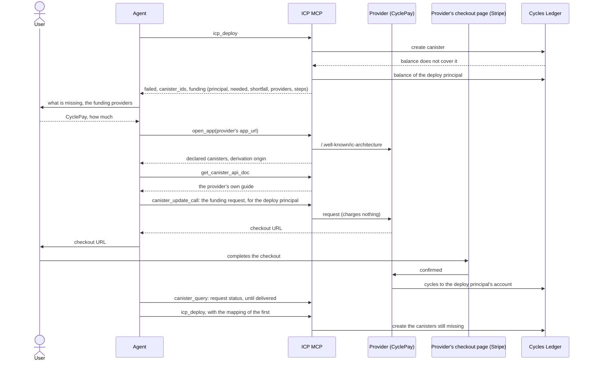

# Funding a deploy: cycles from any funding provider

Status: **implemented** in the PR that adds this file. A design record: what
was built, why this shape, and what was left out.

## Summary

`icp_deploy` creates canisters from the user's cycles balance, and a user
deploying for the first time has none. The deploy tool now tells clients how
canisters are funded, without the server knowing how any one provider takes
a funding request and without a tool of its own:

- **A funding provider is an app, named by its URL.** The server keeps a
  short list of them (`FUNDING_PROVIDERS`), CyclePay first.
- **How to make a funding request is the provider's to say**, through the
  [service-discoverability](https://docs.internetcomputer.org/guides/frontends/service-discoverability/)
  layers the server already reads for every app.
- **`icp_deploy` advertises them.** Its description names the funding
  providers, and a deploy the balance did not cover answers with `funding`:
  the principal added cycles must be delivered to, what is missing, the
  providers, and the steps that are the same for all of them.
- **Whichever provider, the user gets one URL** on which they complete a
  single checkout (a Stripe page, for CyclePay). Then `icp_deploy` works.

No checkout, card detail or movement of cycles between accounts passes
through the server, and the guard on `canister_update_call` is unchanged.

## Problem

`icp_deploy` signs as the user's default Internet Identity account at
`https://cli.id.ai` and creates each new canister from that principal's
Cycles Ledger balance (2T cycles by default). When the balance is short, the
deploy fails at a creation with the icp library's message, which points at a
terminal command, for a user who came through a chat client and may have no
terminal.

Two things were missing for an agent to help:

1. **Whose account?** The deploy principal is not the user's principal in
   any app, so cycles obtained "for me" in a provider's app land where
   `icp_deploy` cannot use them. Nothing served named it.
2. **Which providers?** The server had no word on it. Its instructions said
   that nothing here funds a canister.

The constraints: CyclePay is the first provider and will not be the only
one; the server's policy keeps every checkout outside it; the tool surface
is kept small (a balance tool and a guide tool were dropped from the deploy
group in #266); and the change is confined to this repository, so nothing
can be asked of a provider that it does not already publish.

## What service discoverability already gives

A provider that takes part in ICP MCP publishes everything an agent needs to
make a funding request. Observed on `https://www.cyclepay.org` through the
hosted server, 2026-11-25:

| Layer | Read with | What CyclePay publishes |
|---|---|---|
| Composition: `/.well-known/ic-architecture` | `open_app` | Two declared canisters: the backend and the website. The Cycles Ledger, which the site's bundle also names, is not declared and so is not reachable. |
| Identity: `/.well-known/ii-derivation-origin` | `open_app` | The origin the user's principal at CyclePay is derived for. |
| Behavior: `get_api_doc` | `get_canister_api_doc` | The card flow: read the terms and the current rate; make a request with an amount and a destination, which by the doc's own words charges nothing and answers a URL; the user completes the checkout on Stripe's page; read the status until the cycles are delivered. Limits and refusal codes. |
| Interface: `candid:service` | `get_canister_candid` | The request's arguments, among them a Cycles Ledger destination and the principal whose account receives the cycles. |

The terms were read live (a query). No funding request was made: it would
have created a real one in a user's name.

So the provider-agnostic interface exists already, and it is prose plus
Candid, read at the time of use. The manifest does one more thing: it gates
every call to the provider's canisters (see "Reaching a canister is gated on
the discoverability manifest" in the README), and publishing it is the
operator's acceptance of the
[App Operator Terms](https://internetcomputer.org/icp-mcp/app-operator-terms/).
A provider is in or out by its own act.

## Design

### 1. The list

`imcp2_core::deploy::funding::FUNDING_PROVIDERS`, compiled in, as the
well-known apps and the known sync plugins are:

```rust
pub struct FundingProvider {
    pub name: &'static str,     // "CyclePay"
    pub app_url: &'static str,  // "https://www.cyclepay.org"
    pub checkout: &'static str, // "by card, on Stripe's checkout page"
}
```

A name, the URL `open_app` takes, and a phrase the user can choose by. No
canister id, no method name, no rate, no limit: each of those is the
provider's to change, and its API doc is read when the request is made.

**What an entry takes.** Listing a provider tells users of this server where
to go for cycles, so an entry is added by a reviewed change here, and only
for a provider of which all four hold:

1. Its `app_url` serves a manifest that declares the canister requests are
   made on, and that canister publishes `candid:service` and an API doc.
2. The API doc describes a funding request that names the amount and the
   principal whose Cycles Ledger account receives the cycles, that answers a
   URL where the user completes one checkout, and whose status can be read
   until delivery.
3. The request itself charges nothing and moves no assets: it records what
   the user is about to confirm, on a page of the provider's. Whoever
   reviews the entry checks this independently of the guard, from what the
   method does: the canister's source where it is published, its interface
   and API doc, and a request made and watched.
4. The guard lets the request through, or it could not be made here: a
   method name the guard does not refuse, on a canister with no ICRC-1 or
   ICRC-2 method.

The fourth does not give the third. The guard is a guardrail on the
standard ledger surface and on a list of method names, and its own
description says what it cannot do: tell a bespoke value-moving method under
an ordinary name, such as one that acts on an approval the user gave
somewhere else. A provider whose request moved assets under a plain name
would pass it. No exemption was added for funding, and none of the guard's
limits is lifted by it; what keeps such a provider off the list is the
review of its entry.

### 2. Where `icp_deploy` says it

**In its description.** The description says that new canisters are created
from the user's cycles balance, a cloud engine's excepted, and that a deploy
short of them answers with `funding`, which is the time to add cycles. It
ends with a sentence made from the list: "Funding providers: CyclePay
(https://www.cyclepay.org)." An agent reads it with the tool list, so it can
tell a user who has no cycles where to get them before anything is bundled.

**In the answer of a deploy that ran short.** When the cycles ledger
refuses a creation, the deploy fails as before, with the mapping of what it
did create, and with `funding`:

| Field | |
|---|---|
| `principal` | The deploy principal. Its Cycles Ledger account holds the balance and is the account added cycles must be delivered to. |
| `needed` | `to create × (cycles + what the ledger takes per creation)`, for the canisters the deploy targeted and has no id for. The server counts them: it has read the bundle and the mapping, and thirteen-digit arithmetic is not what a model is good at. |
| `balance`, `shortfall` | The balance read after the deploy, anonymously, and what of `needed` it does not cover. Left out if the ledger does not answer within ten seconds; the rest stands. |
| `providers` | The list. |
| `steps` | What to do next, the same for every provider. |

Two details of the answer:

- **A `shortfall` of `0`.** Cycles can arrive between the refusal and the
  read. Then nothing is to be added, and the steps say only to write the
  mapping back and deploy again; no provider is put forward in the text.
- **Amounts in trillions are exact.** The text gives each amount in T
  beside the exact count, with every digit: an amount that has to be added
  is never shown as less than it is. How many cycles to add is the user's
  to decide, at least the shortfall, and a provider may have a minimum.

**Why only then.** `funding` is attached when the ledger itself refused a
creation for lack of cycles and a canister is still to create, never on a
balance checked ahead of the deploy. The icp library creates a canister
through the Cycles Ledger on an ordinary subnet and through an engine
operator on a cloud engine, where the ledger balance is not what is drawn
on. Which of the two a deploy takes depends on the subnet it resolves, so a
preflight on the balance would refuse deploys that were going to succeed.
The ledger's own refusal is never wrong about that.

The refusal reaches a deploy as text: the icp library turns the ledger's
typed error into a message before handing it on, so that message is the
signal, matched whole. A test builds it from the library's own types and
runs it through the deploy's error rendering, so a release of the library
that words it differently fails there. A failure that only mentions cycles
(an install on a canister that ran out, the ledger refusing another kind of
request) is not taken for it, and a deploy with nothing left to create gets
no `funding` whatever its error says. The description says the same of
cloud engines, so that an agent does not send a user for cycles no deploy
has asked for.

The balance is read after the deploy has ended and while it still holds its
slot, so the read gives way to a stop as well as to its ten seconds: a
server told to stop answers without the number.

The cost: a user with no cycles learns it from a failed deploy. Nothing is
created by a deploy that cannot afford its first canister, and one that can
afford some keeps them, as before. On the hosted server the upload is used
up by that deploy, so the bundle is uploaded a second time afterwards.

### 3. The flow



The request is the one state-changing call of the funding, made as the
user's account at the provider, under an "Actions & questions" session,
through the guard. The checkout is the user's, on a page that is neither the
server's nor the agent's.

The steps the answer carries name this server's tools and the deploy
principal, and nothing of any provider (a test holds them to that). What
differs between providers, the agent reads from the provider.

### 4. Around the tool

- The server's instructions say, in one sentence, that a deploy short of
  cycles answers with `funding` and that the checkout is on the provider's
  page.
- The `deploy-with-mcp` skill has "When the cycles run short", and a
  pitfall on delivering to the wrong account.

## What was considered and left out

- **A tool of its own** (`icp_funding_options`: the balance, what a deploy
  of N canisters needs, the providers). It was the first version of this
  change. It let an agent check before bundling and spared the second
  upload, at the cost of one more tool on a surface that is kept small, a
  count of new canisters the agent had to make itself, and a balance that
  says nothing certain about a deploy to a cloud engine. The deploy tool
  knows all three better.
- **The balance with the upload ticket** (`icp_deploy_upload` reading the
  ledger as it issues one). It would spare the second upload on the hosted
  server. It would also turn a tool that touches nothing outside the server
  into one that waits on Internet Identity and the ledger before every
  upload, for a number that can only advise. Worth revisiting if failed
  first deploys prove costly.
- **A preflight in `icp_deploy`** that refuses before creating anything.
  See "Why only then".
- **A server-side adapter per provider** (one tool call returning the
  checkout URL). Fewer steps for the agent, but provider code in the server,
  a release for every change a provider makes to its interface, and a
  server that itself makes funding requests. The agent already has the
  tools to make one as the user.
- **A deep link per provider** (CyclePay's `llms.txt` documents one that
  names the recipient and the amount). No update call at all, but a
  provider-specific URL template in the list, a landing page in place of a
  checkout page, and no request to follow to delivery. It survives as the
  fallback in words: "the user can still add cycles on the provider's site,
  entering `principal`".
- **A funding section in the manifest, or an on-chain registry of
  providers.** Both are changes outside this repository, and a registry
  anyone can join is not a list this server should recommend from.
- **Operator-configured providers** (an environment variable). The list is
  an endorsement; it changes by review.
- **CyclePay's third-party delivery option** (described in its API doc),
  where the cycles are held for another principal to collect. `icp_deploy`
  uses the user's own account, so a plain delivery to that account is all
  it needs.

## Security and policy

- **Nothing that moves assets is added.** The deploy tool names an account
  and returns a list. The request is a `canister_update_call` like any
  other, refused under exactly the conditions it was refused under before.
- **The guard's limits are its limits here too.** It does not judge a
  bespoke value-moving method under an ordinary name, on a provider's
  canister as on any other. A provider's canister may well carry such
  methods beside its funding request. Listing a provider says nothing of
  those: the steps send an agent to the flow of the provider's API doc, and
  the review of an entry looks at what that doc leads an agent to call.
- **The checkout URL is the provider's.** The server cannot tell a good one
  from a bad one without knowing the provider, which is what it avoids. The
  defences are the reviewed list, the manifest (publishing it is the
  operator's agreement to the App Operator Terms), and the user reading the
  page they complete the checkout on. An allowed checkout host per entry
  would add a mechanical check at the cost of one provider-specific fact; it
  is the first thing to add if this proves too thin.
- **The wrong account is the likely mistake.** A request that delivers to
  its caller delivers to the user's principal at the provider. The answer,
  its steps and the skill each say to name `principal`.
- **What a provider learns**: the user's principal in its app (as for any
  app the user acts in) and the deploy principal, as the account that
  receives the cycles. Card details go to the provider's checkout page and
  reach neither the server nor the agent.

## Not done here

- **A funded deploy end to end.** The read path was exercised live; a
  deploy that runs short, a funding request and a checkout were not. Worth
  one run on staging before release, with attention to how an agent, given
  only the deploy's answer, names the recipient.
- **A deploy against a stand-in ledger.** The tests take the ledger's
  refusal from the icp library's own types and follow it to the `funding`
  answer; they do not run a deploy. The crate has no harness that runs the
  icp library's deploy against stubbed canister calls.
- **Topping up a canister that already exists.** The same providers do it,
  and nothing here speaks of it: `funding` is about the balance deploys
  create from. A sentence in the skill would cover it once someone needs
  it.

## Where it lives

| | |
|---|---|
| `crates/imcp2-core/src/deploy/funding.rs` | The list, the sentence of the description, when a deploy ran short, the `funding` answer and its steps; tests. |
| `crates/imcp2-core/src/deploy/mod.rs` | `icp_deploy`: the description, `funding` in the output, attached after a deploy the ledger refused. |
| `crates/imcp2-core/src/deploy/server.rs` | One sentence in the server's instructions. |
| `crates/imcp2-core/static/skills/deploy-with-mcp.md` | "When the cycles run short". |
| `README.md`, `crates/imcp2-local/README.md` | "Funding a deploy". |
