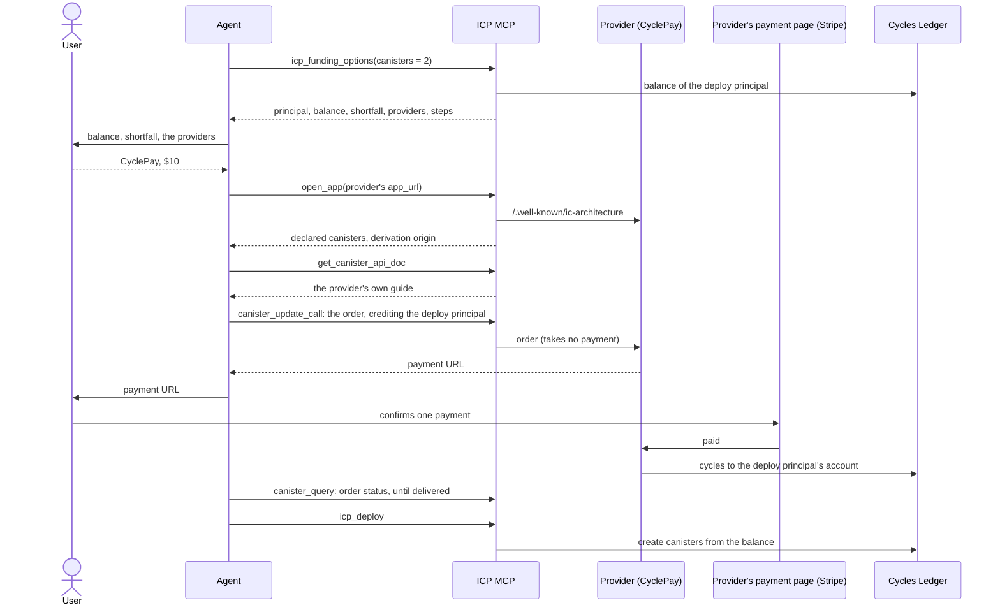

# Funding a deploy: cycles from any payment provider

Status: **implemented** in the PR that adds this file. A design record: what
was built, why this shape, and what was left out.

## Summary

`icp_deploy` creates canisters from the user's cycles balance, and a user
deploying for the first time has none. The server now says where cycles can
be bought, without knowing how any one seller takes an order:

- **A funding provider is an app, named by its URL.** The server keeps a
  short list of them (`FUNDING_PROVIDERS`), CyclePay first.
- **How to order is the provider's to say**, through the
  [service-discoverability](https://docs.internetcomputer.org/guides/frontends/service-discoverability/)
  layers the server already reads for every app.
- **One read-only tool, `icp_funding_options`,** returns the balance, the
  principal bought cycles must be delivered to, the providers, and the steps
  that are the same for all of them.
- **Whichever provider, the user gets one URL** on which they confirm a
  single payment (a Stripe page, for CyclePay). Then `icp_deploy` works.

No payment, card detail or transfer passes through the server, and the
financial guard on `canister_update_call` is unchanged.

## Problem

`icp_deploy` signs as the user's default Internet Identity account at
`https://cli.id.ai` and creates each new canister from that principal's
Cycles Ledger balance (2T cycles by default). When the balance is short, the
deploy fails at its first creation with the icp library's message, which
points at `icp cycles mint`: a terminal command, for a user who came through
a chat client and may have no terminal.

Three things were missing for an agent to help:

1. **How much is there?** Nothing served reported the deploy balance (a
   balance tool existed next to the deploy tools and was dropped in #266).
2. **Whose account?** The deploy principal is not the user's principal in
   any app, so cycles bought "for me" in a seller's app land where
   `icp_deploy` cannot spend them.
3. **Where to buy?** The server had no word on it. Its instructions said
   that nothing here funds a canister.

The constraints: CyclePay is the first provider and will not be the only
one; the server's policy is that it performs no financial operation; and the
change is confined to this repository, so nothing can be asked of a
provider that it does not already publish.

## What service discoverability already gives

A provider that takes part in ICP MCP publishes everything an agent needs to
order from it. Observed on `https://www.cyclepay.org` through the hosted
server, 2026-11-25:

| Layer | Read with | What CyclePay publishes |
|---|---|---|
| Composition: `/.well-known/ic-architecture` | `open_app` | Two declared canisters: the backend ("buy cycles by card, call get_api_doc first") and the website. The Cycles Ledger, which the site's bundle also names, is not declared and so is not reachable. |
| Identity: `/.well-known/ii-derivation-origin` | `open_app` | The origin the user's principal at CyclePay is derived for. |
| Behavior: `get_api_doc` | `get_canister_api_doc` | The card flow: quote with `get_card_terms` and `get_xdr_rate_status`; `create_order` with an amount and a destination, which "moves no money" and answers a `payment_url`; the buyer pays on Stripe's page; `order_status` until `Delivered`. Fees, limits, refusal codes, refunds. |
| Interface: `candid:service` | `get_canister_candid` | `create_order`'s arguments, among them `destination = Ledger` and `beneficiary`: whose Cycles Ledger account is credited. |

`get_card_terms` answered live (orders from $1 to $200, deliveries not
paused). `create_order` was not called: it would have made a real order in a
user's name.

So the provider-agnostic interface exists already, and it is prose plus
Candid, read at the time of use. The manifest does one more thing: it gates
every call to the provider's canisters (see "Reaching a canister is gated on
the discoverability manifest" in the README), and publishing it is the
operator's acceptance of the
[App Operator Terms](https://internetcomputer.org/icp-mcp/app-operator-terms/).
A provider is in or out by its own act.

## Design

### 1. The list

`imcp2_core::deploy::funding::FUNDING_PROVIDERS`, compiled in, as the
well-known apps and the known sync plugins are:

```rust
pub struct FundingProvider {
    pub name: &'static str,      // "CyclePay"
    pub app_url: &'static str,   // "https://www.cyclepay.org"
    pub pays_with: &'static str, // "card, on Stripe's checkout page"
}
```

A name, the URL `open_app` takes, and a phrase the user can choose by. No
canister id, no method name, no fee, no limit: each of those is the
provider's to change, and its API doc is read when the order is made.

**What an entry takes.** Listing a provider tells users of this server where
to spend money, so an entry is added by a reviewed change here, and only for
a provider of which all three hold:

1. Its `app_url` serves a manifest that declares the canister orders are
   made on, and that canister publishes `candid:service` and an API doc.
2. The API doc describes an order that names the amount and the principal
   whose Cycles Ledger account is credited, that answers a URL where the
   user confirms one payment, and whose status can be read until delivery.
3. The order call moves no assets itself, so the guard lets it through: no
   financial keyword in the method's name (`pay`, `buy`, `purchase`, …), no
   ICRC-1 or ICRC-2 method on the canister.

The third is the policy doing its work, and no exemption was added for it.
An order that records what the user is about to pay for passes; a method
that paid would not, and should not.

### 2. The tool

`icp_funding_options` (`canisters?`, `cycles?`), read-only, served wherever
`icp_deploy` is:

| Field | |
|---|---|
| `principal` | The deploy principal. Its Cycles Ledger account holds the balance and is the account an order must credit. |
| `balance` | That account's balance, in cycles. |
| `needed`, `shortfall` | With `canisters`: `canisters × (cycles + ledger fee)`, and what of it the balance does not cover. Computed here, since thirteen-digit arithmetic is not what a model is good at. |
| `providers` | The list. |
| `steps` | What to do with a provider, the same five for every one. |

It needs a signed-in session, to know whose balance, and no more than
"Questions only". It reads the Cycles Ledger and nothing else: providers are
not contacted, so an answer does not depend on any of them being up.

### 3. The flow



Everything above the order is reading. The order is the one state-changing
call, made as the user's account at the provider, under an "Actions &
questions" session, through the guard. The payment is the user's, on a page
that is neither the server's nor the agent's.

The steps the tool returns name this server's tools and the deploy
principal, and nothing of any provider (a test holds them to that). What
differs between providers, the agent reads from the provider.

### 4. `icp_deploy`'s part

- Its description and the server's instructions say where the balance is
  reported.
- A deploy that fails for lack of cycles says so with a pointer to
  `icp_funding_options` appended to its `error`, which both the text and
  the structured content carry. The mapping it returns still holds what it
  did create; the retry after funding creates the rest.
- The `deploy-with-mcp` skill has a section on checking the cycles before
  bundling: on the hosted server an upload is held five minutes, less than a
  payment takes, so funding comes first.

## What was considered and left out

- **A server-side adapter per provider** (`icp_buy_cycles(provider,
  amount)` returning the URL in one call). Fewer steps for the agent, but
  provider code in the server, a release for every change a provider makes
  to its interface, and a server that itself places orders. The agent
  already has the tools to place one as the user.
- **A deep link per provider** (CyclePay's `llms.txt` documents
  `/b/<principal>/<usd>`). No update call at all, but a provider-specific
  URL template in the list, a landing page in place of a payment page, and
  no order to follow to delivery. It survives as the
  fallback in words: "the user can still buy on the provider's site,
  entering `principal`".
- **A funding section in the manifest, or an on-chain registry of
  sellers.** Both are changes outside this repository, and a registry
  anyone can join is not a list this server should recommend from.
- **Asking each provider whether it is up** before listing it. `open_app`
  does that at the next step, and says which canisters are declared.
- **A preflight in `icp_deploy`** that refuses before creating anything. It
  would have to read the bundle to know how many canisters are new, after
  the upload is spent. The agent asks first; a deploy that runs short keeps
  what it created.
- **Operator-configured providers** (an environment variable). The list is
  an endorsement; it changes by review.
- **CyclePay's escrow orders** (`escrow_spender` in its API doc). They hold
  the cycles for a third party to pull. `icp_deploy` spends from the user's
  own account, so a plain delivery to that account is all it needs.

## Security and policy

- **No financial operation is added.** The tool reads a balance and returns
  a list. The order is a `canister_update_call` like any other, refused
  under exactly the conditions it was refused under before.
- **The payment URL is the provider's.** The server cannot tell a good one
  from a bad one without knowing the provider, which is what it avoids. The
  defences are the reviewed list, the manifest (publishing it is the
  operator's agreement to the App Operator Terms), and the user reading the
  page they pay on. An allowed payment host per entry (`buy.stripe.com`)
  would add a mechanical check at the price of one provider-specific fact;
  it is the first thing to add if this proves too thin.
- **The wrong account is the likely mistake.** An order that credits its
  caller delivers to the user's principal at the provider. The tool's
  answer, its steps and the skill each say to name `principal`.
- **What a provider learns**: the user's principal in its app (as for any
  app the user acts in) and the deploy principal, as the account credited.
  Card details go to the provider's payment processor and reach neither the
  server nor the agent.

## Not done here

- **A paid order end to end.** The read path was exercised live; an order
  and a payment were not. Worth one run on staging before release, with
  attention to how an agent, given only the tool's answer, names the
  beneficiary.
- **Topping up a canister that already exists.** The same providers do it
  (CyclePay takes a `Canister` destination), and the tool says nothing of
  it: it reports the deploy balance. A sentence in the skill would cover it
  once someone needs it.

## Where it lives

| | |
|---|---|
| `crates/imcp2-core/src/deploy/funding.rs` | The list, the tool's output and steps, the shortfall, the hint a short deploy gets; tests. |
| `crates/imcp2-core/src/deploy/mod.rs` | `icp_funding_options` in the deploy tool group. |
| `crates/imcp2-core/src/deploy/server.rs` | One sentence in the server's instructions. |
| `crates/imcp2-core/static/skills/deploy-with-mcp.md` | "Before a deploy that creates canisters: check the cycles". |
| `README.md`, `crates/imcp2-local/README.md` | "Funding a deploy". |
