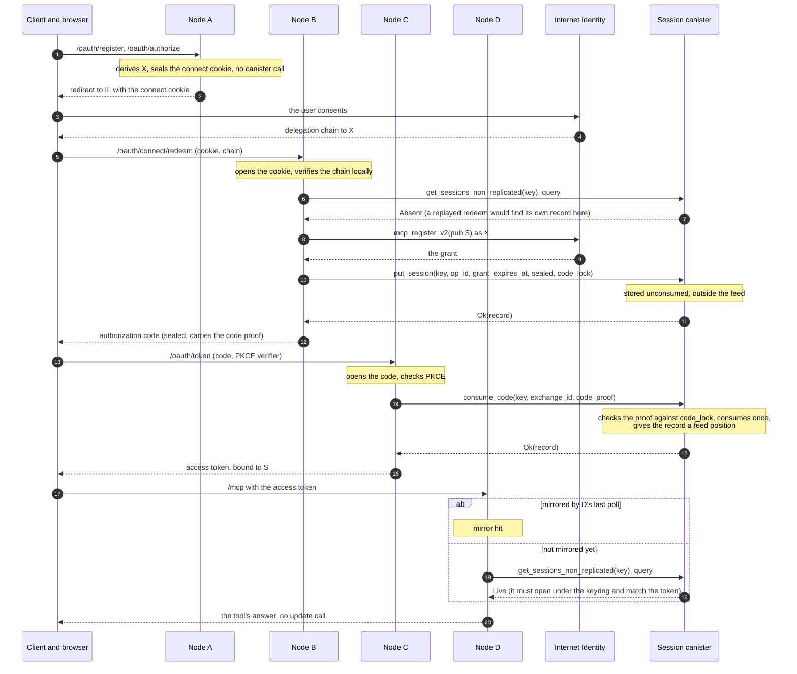
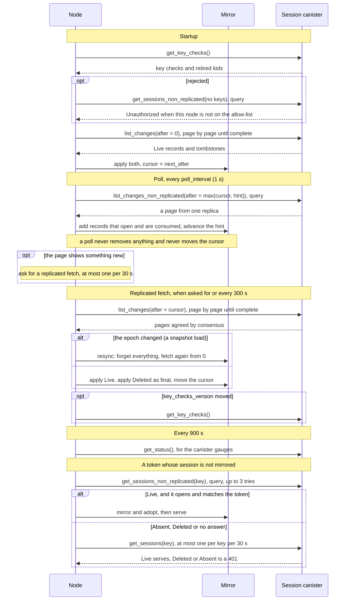
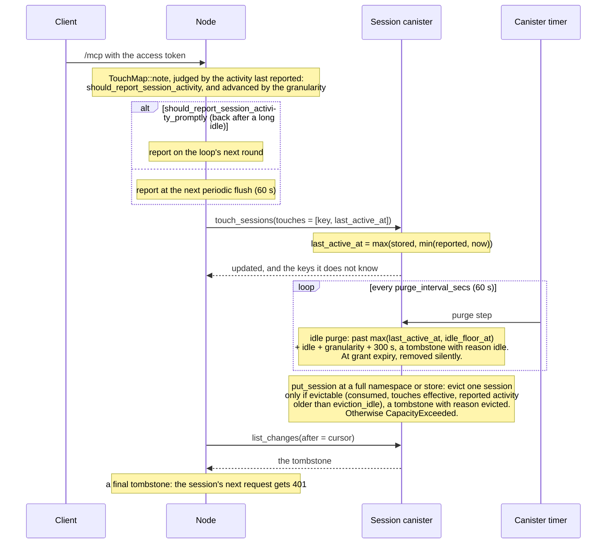

# Shared sessions across imcp2 processes: design record

Status: **implemented**, uncommitted on `igor/session-sharing`, for release 0.7.0. Not yet run on
staging or on GitHub.

- **Implemented and reconciled here:** the canister's contract (`crates/imcp2-session-api`), the
  canister itself (`crates/imcp2-session-canister`) and its reproducible build
  (`scripts/build-session-canister.sh`, run in the pinned image of
  `scripts/session-canister.Dockerfile`); everything in `src/shared` (the formats and cryptography,
  the mirror, the exchange cache, touches, the registrar, the metrics, the canister client, the sync
  loop, `resolve` and the public `SharedSessions` API); the additive seams in `Identities`; the
  shared branches of the OAuth flow (`src/auth/shared_flow.rs`) and
  `McpServer::with_shared_sessions`; the binary's configuration, `imcp2 shared-config-check`,
  `imcp2 shared-key-check`, `/ready/shared` and the `/version` block (`src/shared_setup.rs`,
  `src/main.rs`); the in-process, multi-instance and PocketIC suites (11); the CI jobs, the release
  assets, the deploy workflow and the staging host's systemd drop-in (12); and the runbook
  (`docs/shared-sessions-operations.md`).
- **Verified locally only:** every suite in 11, and a smoke run of two binaries and the canister
  on a local PocketIC 15 (11).

A `TODO(reconcile)` comment remains only where something cannot be known from the code: a
measurement on staging, an ownership decision, or a sign-off.

This document records the design as built, the decisions behind it, and where the build refined the
plan. Code is referenced by symbol (file plus function, type, or constant), never by line number.
Section numbers are kept stable so that code comments can cite them ("design §4.7").

## Summary

Several imcp2 processes, behind a load balancer that is not sticky, serve one user's sign-in and
tool calls interchangeably. They share Internet Identity (II) sessions through **one ICP canister**:

- **The canister stores each granted session sealed.** The record holds the session key S under a
  deployment keyring that only the imcp2 nodes have. The canister never sees inside it. Records
  enter a **change feed** when their authorization code is exchanged. Every node mirrors the feed.
- **Every short-lived credential is self-contained.** The connect cookie, the authorization code,
  the access token and the client id carry what the next hop needs. No hop depends on the memory
  of the node that served the previous one.
- **Exactly two awaited canister updates per sign-in:** `put_session` at redeem (durability) and
  `consume_code` at `/oauth/token` (single use). `/mcp` makes no update call for a mirrored
  session.
- **A client is told to sign in again (401) only on an authoritative fact.** An outage, replication
  lag, key drift or a newer format answers 503 with `Retry-After`.
- **With no canister configured, imcp2 behaves as before.** The one exception is that
  `imcp2_dcr1.` client ids are decoded in both modes.

## 1. Context and goals

**Before this work**, imcp2 kept all OAuth and II session state in process memory:

- `AuthStore` (`src/auth.rs`) holds DCR clients (persisted per node to `CLIENTS_FILENAME`), pending
  connects (`AuthzPending`), codes (`CodeGrant`) and tokens (`TokenInfo`).
- `Identities` (`crates/imcp2-core/src/identities.rs`) holds each session's key S, its grant
  expiry and access level, and its app-delegation cache.

A client therefore has to come back to the node that created its state. Behind a non-sticky load
balancer, every hop of `/oauth/register → /oauth/authorize → II → /oauth/connect/redeem →
/oauth/token → /mcp` can land on a different node, and each hop then fails.

**Goals:**

- **Interchangeable backends:** ic-gateway nodes, or several standalone `imcp2` binaries.
- **Fast propagation:** a session created on one node is usable on the others as soon as possible
  (about 1 to 2 s through the feed, or at once through a read-through).
- **Inactive sessions are purged** from the canister, and every session is removed at its grant
  expiry.
- **The ic-bn-lib pattern:** the shape follows ic-bn-lib's custom-domains canister and its API
  crate (commit b3b7e97). A types-only API crate is shared by the canister and the client, and the
  client lives in the application.

**Non-goals:**

- Sharing app delegations. They stay per node (see 13).
- Wiring ic-gateway. That is a follow-up (14).
- vetKeys or any key management in the canister (2.1).

## 2. Decisions

### 2.1 Scope decisions

These were settled before the design.

| Question | Decision |
|---|---|
| What is shared? | **Everything a sign-in creates:** granted II sessions (including S), access tokens, in-flight connects, single-use codes, and DCR clients. |
| Encryption | **A pre-shared 32-byte key** on every node, XChaCha20-Poly1305, with a key id (kid) byte for rotation. **Not vetKeys.** |
| Idle purge | **30 days by default**, configurable. Sessions are also always removed at grant expiry. |
| Scope | **imcp2 only.** New crates live in this workspace. ic-gateway is a follow-up note (14). |
| Unconfigured behaviour | **As today**, except the DCR id decoder (3.6). |

**What ships in 0.7.0:**

- `imcp2-session-api`: published, types only.
- `imcp2-session-canister`: not published. It ships as a reproducible wasm release asset.
- An additive shared mode in imcp2, turned on in the binary by `IMCP2_SHARED_CANISTER_ID`.
- A runbook (`docs/shared-sessions-operations.md`).

### 2.2 Design decisions

| # | Decision | Why | As built |
|---|---|---|---|
| D1 | **Granted sessions are canister records.** The sealed record (`RecordPayload`: sid, S, grant expiry, access level) is stored once at redeem and never rewritten. Every node mirrors the consumed records through the change feed, treats its mirror as the existence authority, decrypts a record on first use, and reads through on a miss. | The put/get-and-sync model asked for. S exists only sealed (canister and mirrors) or in a node's RAM. | Canister: `State::put_session` is create-only. Mirror: `Mirror` (6.2). Sync loop: `sync.rs` (6.3). |
| D2 | **Self-contained credentials.** The cookie, code and token are sealed. The code and the token are bound to S (`code_proof`, `at_bind`), so the deployment key alone cannot forge a usable one. The DCR `client_id` is self-describing and unsealed. | Register and authorize, both unauthenticated, make no canister call. The short hops have no replication lag. | `seal`, `codec`, `dcr` (3). |
| D3 | **Two awaited updates per sign-in.** `put_session` at redeem fails closed: no code is issued without a durable record. `consume_code` at `/oauth/token` gives single use through consensus, checks the code proof and returns the record. A record enters the feed only when its code is consumed. | Only single use and durability need consensus. Abandoned sign-ins never reach a mirror. | Canister: `State::put_session`, `State::consume_code`. Flow: `shared_flow::redeem`, `shared_flow::token` (7). |
| D4 | **Queries are hints.** A query answer (from `get_sessions_non_replicated` or `list_changes_non_replicated`) can add an AEAD-valid, consumed record to a mirror, but **never removes anything**. Only replicated reads (`get_sessions` and `list_changes`, update calls) delete, move the cursor, start a resync, or justify a 401. | A query answer comes from one replica and is not certified. A sealed record cannot be forged; a tombstone or an absence can. | `Mirror::upsert` refuses a record under a final tombstone; only `Mirror::apply_final_tombstone` deletes. `Inner::poll_once` only adds; `Inner::replicated_fetch` alone deletes (6.3). |
| D5 | **401 only on an authoritative fact.** Anything else (outage, lag, key drift, a newer format, a full cache) gets 503 `temporarily_unavailable` with `Retry-After: 5` and no `WWW-Authenticate`. | A 401 makes an MCP client run a full re-authorization. | `OpenError::{Invalid, Unavailable}`, `CodecError::Newer`, `Resolution`, `shared_flow::mcp_unavailable` (6.5, 6.6). |
| D6 | **A snapshot load is disaster recovery.** The canister detects one from its own **canister history** (`canister_info`), which a snapshot load does not rewind. It then bumps `epoch` and raises `idle_floor_at`. Nodes discard their mirrors and resync. Operators replay admin changes from a journal. Sessions created after the snapshot must re-authorize. | Correct and simple. Automatic re-push from the nodes proved fragile in review. Routine upgrades never load snapshots. | `history.rs`, `State::observe_history`, `State::check_restore` (4.7). `canister_version` cannot be used (4.7). |
| D7 | **Idle purge** at `max(last_active, idle_floor_at) + idle + granularity + 300 s`, and silent removal at grant expiry. Touches are batched and sent only when they can move a deadline. A record is evicted for capacity only when its `last_active` can be trusted, apart from a user returning in the seconds before the node's prompt report lands (4.5). | Costs nothing at the 30 d default. Lowering the idle timeout later never logs out an active user. | `rules.rs` (4.4, 4.5), `TouchMap` (6.8). |
| D8 | **Additive library API.** `McpConfig` and `McpServer::new` are unchanged. The new entry point is `McpServer::with_shared_sessions(config, &shared)`. | ic-gateway builds `McpConfig` as a struct literal. | `src/lib.rs`, `src/shared/sessions.rs` (6.1). |

### 2.3 The rejected alternative: sealed credentials

The design panel scored a "sealed credentials" variant slightly higher. In it, the canister holds
no secrets. S rides sealed inside the authorization code (in the redirect URL) and inside access
tokens, which third-party MCP platforms store for a long time. It was rejected for two reasons:

- **It does not store sessions in the canister,** which is what was asked for.
- **Its key compromise is worse.** With the deployment key, any captured token yields a 30-day II
  session key that imcp2 cannot revoke.

In this design, exposing S needs the key **plus** either the canister's state or a connect cookie
captured during its at most 10 minutes of life (9.2).

## 3. Formats and cryptography

All of this is in `src/shared/{keys,seal,codec,dcr}.rs`. These files are pure: no network, no clock
of their own. **Every label, prefix and byte layout is a wire contract** (`src/shared/mod.rs`,
"Wire contract"). Nodes running different releases read them, and they outlive a deploy: records
stay up to 31 days, and clients hold codes, tokens and client ids. None changes in place; a change
is a new label or version. Golden vectors pin the bytes. They were computed independently of the
crate, with Python's standard library and the `cryptography` package (`test_vectors.rs`).

### 3.1 Keyring and key checks

`SealingKeys` is the deployment keyring.

- **Spec:** `kid:base64` entries, such as `2:<key>,1:<key>`, separated by commas or line breaks, so
  the same text works inline in an environment variable and as a file (`SealingKeys::parse`,
  `SealingKeys::from_file`).
- **Kids** are 1 to 255; kid 0 is refused, so a zeroed header never names a key. Each kid appears
  once.
- **Keys** are 32 bytes in standard or URL-safe base64, padded or not.
- **Order is the sealing preference,** among Verified kids only (6.5).
- **Hygiene:** keys are held in `Zeroizing` storage and decoded without an unzeroized heap copy.
  `Debug` shows only kids and fingerprints. `KeysError` never carries key material.
- **Key check:** `HKDF-SHA256(ikm = K[kid], salt = empty, info = "imcp2/keycheck/v1")[..16]`
  (`SealingKeys::key_check`, `KEY_CHECK_INFO`). The operator publishes it in the canister
  (`admin_set_key_check`). Each node compares it with its own to learn whether it holds the fleet's
  key under that kid. It is a PRF output and reveals nothing about the key.
- **Fingerprint:** the hex of the check's first 8 bytes (`SealingKeys::fingerprint`), for logs and
  the `key_info` metric.

### 3.2 Derivations

`connect_secret` is 32 random bytes chosen at authorize. `ns` and `issuer` are per imcp2 instance.

| Value | Derivation (`keys.rs`) | Purpose |
|---|---|---|
| `ns` | `SHA-256("imcp2/ns/v1\0" ‖ ii_canister ‖ "\0" ‖ issuer)[..16]`, where `issuer = {public_url}{mcp_path}` | Namespace. Prefixes every record key and is the context of codes and tokens, so nothing crosses instances. |
| record key | `ns ‖ SHA-256("imcp2/rk/v1\0" ‖ ns ‖ sid_uuid)[..16]` (`record_key`) | 32-byte canister key. **Unkeyed,** so a key rotation does not move records. The sid is random, so the key reveals nothing about it. |
| `x_seed` | `HKDF(connect_secret, info = "imcp2/connect/x/v1")` | The registration identity X shown to II. |
| `s_seed` | `HKDF(connect_secret, info = "imcp2/connect/s/v1")` | The session key S. **Deterministic per connect:** a redeem retried on another node binds the same S at II, which is idempotent. |
| `put_op` | `SHA-256("imcp2/put/v1" ‖ connect_secret)[..16]` | `op_id` of `put_session`. A replayed redeem gets the first record back. |
| `code_proof` | `HKDF(S, info = "imcp2/code-proof/v1")[..16]` | Carried in the code and presented to `consume_code`. Derived from S, so the key alone cannot forge it. |
| `code_lock` | `SHA-256(code_proof)[..16]` | Stored at `put_session`, so the canister checks a proof it never saw. |
| `at_bind` | `HKDF(S, info = "imcp2/at-bind/v1")[..16]` | Carried in every access token. A token is honoured only if it matches the record's S. |
| `exchange_id` | `SHA-256("imcp2/exchange/v1" ‖ code_id ‖ code_verifier)[..16]` | Makes a retried token request the same exchange. |
| `client_hash` | `SHA-256(client_id)[..16]` | What a cookie and a code remember of their client. |
| AEAD subkey | `HKDF(K[kid], salt = "imcp2/sealed/v1", info = "imcp2/sealed/v1/" ‖ label)` (`SealingKeys::subkey`) | One cipher key per purpose. |
| nonce subkey | as above, info `"imcp2/sealed/v1/nonce/" ‖ label` (`SealingKeys::nonce_subkey`) | Synthetic IVs, kept apart from the cipher key. |

The sid keeps the legacy form `sess-{uuid}` (`format_sid`, `parse_sid`, one spelling per sid), so a
shared-mode connect `state` looks the same to II. Proofs and bindings are compared in constant time
(`ct_eq`).

### 3.3 The sealed envelope

```text
envelope = fmt (0x01) ‖ purpose ‖ kid ‖ nonce[24] ‖ ciphertext ‖ tag[16]
AAD      = "imcp2/sealed/v1\0" ‖ envelope[0..3] ‖ ctx
```

The cipher is XChaCha20-Poly1305 under the purpose's subkey (`seal::seal`, `seal::open`). The header
is in the clear and authenticated. `ctx` is not stored: the opener supplies it from what it already
knows, so a value sealed for one session or instance cannot be replayed into another.

| Purpose (`Purpose`) | Byte | Label | Text form | `ctx` | Nonce |
|---|---|---|---|---|---|
| `Record` | 1 | `record` | none, raw bytes in the canister | the record key | random |
| `Connect` (`mcp_connect` cookie) | 2 | `connect` | `imcp2_cx1.` | `ns ‖ sid_uuid` | random |
| `Code` | 3 | `code` | `imcp2_ac1.` | `ns` | random |
| `AccessToken` | 4 | `access-token` | `imcp2_at1.` | `ns` | **synthetic** |

**Synthetic IV** (`Nonce::Synthetic`): `nonce = HMAC-SHA256(nonce_subkey, header ‖ ctx ‖
plaintext)[..24]`. The same exchange therefore yields the identical token on any node, and two
different plaintexts never share a nonce. `ctx` has a fixed length per purpose, so the
concatenation is unambiguous.

The canister reads exactly one byte of the envelope: byte 2, the kid, which
`admin_purge_sessions{kid}` matches (`SEALED_KID_OFFSET` in the canister's `state.rs`).

### 3.4 Text forms

A text value is `imcp2_` ‖ family (`cx`, `ac`, `at`) ‖ version digits ‖ `.` ‖ unpadded base64url of
the envelope (`seal_text`, `open_text`).

- `text_family` only routes: a shared-mode value goes down the shared path, and a legacy
  `mcp-token-…` or `client-…` value down the legacy one. Validity is for `open_text` to decide.
- **A newer version** of the right family (`imcp2_at2.`) is `Unavailable` (`newer_format`), whatever
  its length.
- **Anything else malformed is `Invalid`:** another family, a version that is not a plain number,
  a value of this version longer than `MAX_TEXT_LEN` (4096, since no browser keeps a longer
  cookie), or bad base64.

### 3.5 Payloads and codec versioning

`codec.rs` defines the plaintexts:

```text
payload = writer_ver u8 ‖ min_reader u8 ‖ fixed fields (big-endian) ‖ u16-length strings [‖ newer fields]
```

| Payload | Fields | Lifetime |
|---|---|---|
| `RecordPayload` | `sid_uuid`, `s_seed`, `grant_exp_ns`, `read_only` (0 unknown, 1 false, 2 true), `created_ns` | until grant expiry or purge |
| `ConnectPayload` | `created_at_s`, `connect_secret`, `client_hash`, `challenge` (optional 32-byte S256 digest), `redirect_uri`, `client_state` | 600 s ± `CLOCK_SKEW` |
| `CodePayload` | `sid_uuid`, `issued_at_s`, `client_hash`, `challenge`, `code_id`, `code_proof` | `CODE_TTL` (120 s) ± `CLOCK_SKEW`; single use |
| `TokenPayload` | `sid_uuid`, `grant_exp_ns`, `consumed_at_s`, `at_bind` | until the record's grant expiry, and only while the record exists |

- **PKCE** travels as the raw 32-byte SHA-256 digest of an S256 challenge, not its 43-character
  text (`s256_challenge_digest`). It is checked in constant time (`pkce_verifies`).
- **Cookie size.** `ConnectPayload::encode` refuses `redirect_uri` plus `client_state` over 2600
  bytes (`MAX_CONNECT_STRINGS_LEN`), which keeps the cookie at about 3.7 KB, under a browser's
  4 KiB.
- **Secrets stay redacted.** Every payload's `Debug` redacts its secrets, and the buffers are
  zeroizing and sized up front, so no grown-and-abandoned buffer keeps a secret.
- **`CLOCK_SKEW`** (60 s) is defined once, in the API crate, and applied wherever one side checks a
  time the other side set.

**Versioning.**

- Fields are append-only, and a reader ignores trailing bytes.
- `min_reader` is raised only for an incompatible change. A reader below it gets
  `CodecError::Newer`, which is answered with **503, never 401**.
- **The two-release rule:** readers ship one release before writers. A release that starts writing
  a new field must follow one that already reads past it. The golden vectors feed next-version
  payloads to this decoder (`a_next_version_payload_decodes_or_is_newer`).

### 3.6 Self-describing DCR client ids

In shared mode, `/oauth/register` mints a client id instead of storing a registration
(`dcr::encode_client_id`):

```text
imcp2_dcr1. ‖ base64url-nopad( v = 1 (u8) ‖ n (u8) ‖ n × (len u16 BE ‖ redirect_uri) )
```

- **Deterministic and unkeyed.** The same URIs give the same id. The id is neither sealed nor
  dependent on the keyring, so a key rotation never invalidates it.
- **Bounded like a stored registration.** `MAX_REDIRECT_URIS` and `MAX_REDIRECT_URI_LEN` apply, and
  the whole id is at most 2048 characters. `decode_client_id` re-applies every limit, because the id
  comes from the client, and refuses anything the encoder could not have produced.
- **Checked like a stored registration.** `AuthStore::validate_client` (`src/auth.rs`) decodes the
  id and calls `redirect_allowed(Some(&ClientReg::new(uris)), redirect_uri)`. That matches loopback
  on any port and re-applies the hosted-redirect allow-list (`redirect_uri_permitted`). The id
  admits nothing open DCR would not.
- **Decoded in both modes.** This is the one deviation from "unconfigured means today". It keeps
  clients working after sharing is turned off or a release is rolled back. An id that does not
  decode falls through to the DCR store, which does not hold it.

Minting is shared mode only: `/oauth/register` calls `shared_flow::client_id_for` (7).

## 4. The canister

### 4.1 Crates and build

- **`crates/imcp2-session-api`** is the contract, mirroring ic-bn-lib's `custom-domains/api`. It
  holds:
  - **`CANDID`**, the hand-written `imcp2_session.did`;
  - every `.did` type in Rust, with a `Result` alias per `*Result` variant;
  - **the constants** both sides must agree on (`constants.rs`);
  - **the rules** both sides evaluate (`rules.rs`, 4.4 and 4.5);
  - **`Config::apply`**, the one validation of the canister configuration;
  - the error types and their shared code space (`errors.rs`, 4.2).

  It builds for wasm32 and native. Its tests check every named type of the `.did` and the install
  argument against the Rust types in both directions (`src/tests/contract.rs`). They also pin golden
  Candid bytes for every request and response, show that an error case a newer canister adds
  decodes on an older reader, and check that a full page, lookup or touch batch fits the message
  limits (`src/tests/wire.rs`). Method names are not part of the crate: they are checked where they
  are used, by the canister against the interface it exports and by imcp2's client against the
  `.did`'s service (`the_method_table_is_the_did_service`).
- **`crates/imcp2-session-canister`** is the implementation (`publish = false`, `cdylib` + `rlib`):
  - `state.rs`: `State<M: Memory>`, every method as a pure function of the stable state and an
    `Env`. Time, the caller, controller status and the restore counter come in through `Env`, so
    the same code runs in the wasm, in native tests, and in imcp2's in-process double
    (`MemoryCanister`, 4.7).
  - `storage.rs`: the stable layout and its encodings (4.8).
  - `history.rs`: reading the canister history for restore detection (4.7).
  - `lib.rs`: the entry points, the purge timer, `inspect_message`, and `export_candid!`.
    `exported_interface_equals_the_did` checks the exported interface against the `.did` with
    `service_equal`.
- **The client lives in imcp2.** The canister never links ic-agent, and imcp2 never links ic-cdk.
- **`scripts/build-session-canister.sh`** builds a reproducible wasm. It uses `--locked`,
  `--remap-path-prefix` for the checkout, the cargo home, the toolchain's rust-src and an outside
  target dir, `ic-wasm shrink`, `candid:service` metadata, and `gzip -n`. Its outputs are the
  `.wasm.gz`, its sha256, the `.did`, and `build-info.txt` (toolchain versions and `GIT_SHA`, which
  `get_status` reports). The script fails unless the module exports exactly the `.did`'s query and
  update methods, checked both with its own comparison and with `ic-wasm check-endpoints`.

### 4.2 Interface

Times are Unix seconds of IC time unless a name ends in `_ns`.

**Conventions.** Every method takes one record and returns `variant { Ok : …; Err : … }`, so that an
argument can gain `opt` fields and a reply can gain fields without a new method. A method a node
acts on is an **update**: its answer went through consensus. The two reads a node also takes as
hints have a **query twin** named `*_non_replicated` (D4).

| Method | Kind | Callers | What it does |
|---|---|---|---|
| `put_session` | update | authorized nodes | Stores a new, unconsumed record at redeem (`/oauth/connect/redeem`), before the code is issued. Idempotent per `op_id`. |
| `consume_code` | update | authorized nodes | At `/oauth/token`: the single-use code exchange, decided by consensus. Checks the code proof, marks the record consumed (it enters the feed), returns it. Idempotent per `exchange_id`. |
| `touch_sessions` | update | authorized nodes | Activity reports (`TouchSessionsArg`): raises `last_active_at`, at most 2000 per call. |
| `get_sessions` | update | authorized nodes | Looks up at most 100 keys (`GetSessionsArg`): `Live`, `Deleted` or `Absent`, agreed by consensus. |
| `get_sessions_non_replicated` | query | authorized nodes | The same lookup from one replica: a hint. |
| `list_changes` | update | authorized nodes | A page of the compacted change feed, agreed by consensus. |
| `list_changes_non_replicated` | query | authorized nodes | The same page from one replica: a hint. |
| `get_key_checks` | update | nodes, controllers | Published key checks and retired kids (`GetKeyChecksArg`, empty). |
| `get_status` | update | nodes, controllers | Everything an operator or a gauge needs (`GetStatusArg`, empty). |
| `admin_update_config` | update | controllers | Applies a `ConfigPatch`; re-arms the timer with an immediate run. |
| `admin_set_key_check` | update | controllers | Publishes a kid's check (`SetKeyCheckArg`); `replace = opt true` is needed to change one. |
| `admin_retire_kid` | update | controllers | Retires a kid for good (`RetireKidArg`). |
| `admin_purge_sessions` | update | controllers | Starts a resumable purge by namespace, kid, opener and creation time (`PurgeFilter`). |

`get_key_checks` and `get_status` have no query twin: a node acts on both answers (its kid states,
its gauges), and an operator reads them rarely. The sequence diagrams in 8.5 show which call each
step of a sign-in, the sync loop and the activity reports makes.

**There is no `http_request` and there are no public metrics.**

**Install argument:** `variant { Init : ConfigPatch; Upgrade : opt ConfigPatch }`.

- `Init` is accepted only on empty stable memory.
- `Upgrade` is accepted only on an upgrade, of a known schema.
- Anything else traps, which fails the install or upgrade and keeps the previous module.

**Configuration** (`Config`, validated as a whole by `Config::apply`):

| Field | Default | Range |
|---|---|---|
| `authorized` | empty = nobody | at most 32 principals, no duplicates, never anonymous |
| `idle_timeout_secs` | 2 592 000 (30 d) | 3600 to 31 536 000 |
| `max_sessions` | 2 000 000 (a memory tripwire) | at least 1 |
| `max_sessions_per_namespace` | 1 000 000 | 1 to `max_sessions` |
| `purge_interval_secs` | 60 | 10 to 3600 |
| `purge_batch` | 2000 | 100 to 20 000 |

**Errors** are records, not variants (`errors.rs`):

```candid
type PutSessionError = record { err_code : nat64; err_case : opt PutSessionErrorCase; err_str : text };
```

- `err_case` names the case (`PutSessionErrorCase`, `ConsumeCodeErrorCase`, or `CommonErrorCase`
  for every other method). It sits inside an `opt` so that cases can be added: Candid decodes a
  variant case the reader does not know, inside an `opt`, as `null`.
- `err_code` is one code space shared by every error type, documented in the `.did` and never
  reused: 1 `Unauthorized`, 2 `InvalidArgument`, 10 `AlreadyExists`, 11 `Deleted`, 12
  `GrantExpired`, 13 `CapacityExceeded`, 20 `AlreadyConsumed`, 21 `BadProof`, 22 `NotFound`, 23
  `CodeExpired`, 30 `PurgeInProgress`. An older reader still has it when it sees `err_case = null`.
- `err_str` describes the error, with the detail of an `InvalidArgument` (which bound or format).
- A node treats an `err_case` it does not know like any condition it has no handling for: no
  definite answer, so 503 and a retry, never a 401 or `invalid_grant`.

**Evolution rules,** pinned by the API crate's wire tests:

- Records only gain `opt` fields. (A purge filter's existing conditions are required variants, so
  that a typo cannot widen a purge; a condition added later would be an `opt` field without that
  protection, 13.)
- **Error cases may be added** (`an_unknown_error_case_decodes_as_none`).
- **Every other returned variant never gains a case.** A reader rejects an unknown case, which would
  fail the whole reply on every older node. Tombstone reasons are text for the same reason.
- Methods are only ever added.

### 4.3 Method semantics

No method awaits, so every update is atomic. Every method validates and decides before it writes.
The only writes allowed before a refusal are the restore check and the caller's last-seen time, and
a refused caller writes nothing at all.

**`put_session`** (`State::put_session`)

1. Check the caller.
2. Validate the lengths: key 32, `op_id` 16, `code_lock` 16, and `sealed` 3 to 1024 bytes
   (`MIN_SEALED_LEN` to `MAX_SEALED_LEN`). The minimum is the envelope's header, so that every
   record carries the key id (byte 2, `SEALED_KID_OFFSET`) a purge by kid matches against.
3. Look at the key:
   - the same key with the same `op_id` → `Ok(existing)`, whatever the retry's other fields say;
   - a different `op_id` → `AlreadyExists`;
   - a tombstone → `Deleted`.
4. Check the grant: `grant_expires_at ≤ now` → `GrantExpired`; beyond `now + MAX_GRANT_ACCEPTED`
   (31 d) → `InvalidArgument`.
5. Make room (4.5): evict at most one record, or refuse with `CapacityExceeded`.
6. Insert the record **unconsumed and outside the feed** (`seq = 0`), with `last_active = created =
   now`, `opened_by` = the caller's index in the callers table, and the `code_lock`.

**`consume_code`** (`State::consume_code`). The order of checks is deliberate:

1. Absent → `NotFound`. Tombstoned → `Deleted`.
2. **The proof:** `SHA-256(code_proof)[..16] == code_lock`, compared in constant time
   (`proof_matches`). A wrong proof → `BadProof`, and the record is untouched.
3. Already consumed: the same `exchange_id` → `Ok(record)`; another → `AlreadyConsumed`. **No
   window applies here.** The outcome of an exchange is fixed once it happened, so a slow retry from
   any node gets the same record, and so the same token.
4. `now > created + CONSUME_WINDOW` (300 s, canister clock) → `CodeExpired`.
5. Consume: assign the next feed position, record `consumed_by = exchange_id` and `consumed_at =
   now`, set `last_active = now` (the exchange is the session's first use, and the time its tokens
   carry, so a node that has not reported the session yet judges its age as the canister does,
   4.4), and move the record from the `unconsumed` index into `by_seq` and `by_last_active`.

*Refinement over the plan:* the plan checked the window first. As built, a consumed record answers
its own exchange at any time, and another exchange is told the code was used rather than that it
expired.

**`touch_sessions`** (`State::touch_sessions`)

- Every key is validated before the first write.
- A consumed live record takes `last_active = max(last_active, min(touch, now))`. Activity is never
  lowered, and a node clock ahead of the canister's is never trusted.
- Any other key (absent, deleted, or unconsumed, for which no token can exist) comes back in
  `unknown`. A touch never creates or resurrects anything.

**`get_sessions`** (`State::get_sessions`)

- Answers in request order, with `epoch` and `now_ns`.
- **Unconsumed records are returned too,** so a redeem replayed on another node can recognize its
  own put by `op_id`. The caller must check `consumed_at`.
- `Absent` is authoritative only from `get_sessions`, never from its query twin.

**`list_changes`** (`State::list_changes`)

- **A compacted feed:** the current state of each key whose feed position is after `after`, in
  position order. Only consumed records and tombstones have a position.
- `limit` defaults to 500 (`DEFAULT_PAGE_LIMIT`) and is clamped to 1 to 1000 (`MAX_PAGE_LIMIT`).
- `complete` means nothing exists after `next_after`.
- `next_after = complete ? max(after, head) : seq of the last change`. A cursor therefore also moves
  past positions that compaction removed.
- Each page carries `head`, `epoch`, `now_ns`, `idle_timeout_secs`, `idle_floor_at` and
  `key_checks_version`, so a node learns configuration changes from the feed itself.
- **Positions** are `max(head + 1, now_ns)` (`State::next_seq`). `head` is never lowered by the
  canister, but a snapshot load rewinds it, and until the canister notices the load (4.7) a page
  can carry a `head` below a node's cursor under the old epoch. A node therefore compares
  positions only within one epoch (6.3). The clock term keeps new positions above everything a
  node has seen even after a snapshot load rewinds `head`.

**Key checks**

- `admin_set_key_check(record { kid; check; replace })`:
  - kid 0 is refused, and a retired kid cannot be published again;
  - the same value again is a no-op, so an admin-journal replay is safe;
  - a different value needs `replace = opt true` (`null` means false), so a typo cannot silently
    invalidate a key the fleet is sealing with.
- `admin_retire_kid(record { kid })` removes the check and records the kid as retired. It is
  idempotent, and it can retire an unpublished kid before anyone uses it.
- Every change bumps `key_checks_version`, which nodes see on every feed page.

**`admin_update_config(patch)`**

- Lowering the idle timeout raises `idle_floor_at` to now (4.4). Raising it does not.
- On success the purge timer is re-armed with an immediate run, **even for an empty patch.** The
  runbook's `admin_update_config(record {})` after a snapshot load relies on that (4.7). A refused
  call does not re-arm, so it cannot keep pushing the next purge back.

**`admin_purge_sessions(filter)`**

- Matches every condition of `PurgeFilter`: `namespace` (16 bytes; the scan then covers only that
  key range), `kid` (envelope byte 2), `opened_by`, `created_from`, `created_to`. Each is a
  required `variant { Any; Is : T }` (`Match<T>`), and all `Any` purges everything.
- **Why required variants.** Candid drops record fields a type does not declare, and dfx annotates a
  textual argument with the canister's published interface before sending it. With optional fields,
  a misspelled one silently became "no constraint": alone it purged every session, next to correct
  fields it widened the purge. Now a misspelled or missing field, or a misspelled tag, is refused
  before the call is made and when it is decoded (`a_misspelled_or_missing_purge_field_is_refused`
  runs the arguments through the annotation dfx applies). The stored job keeps `Any` as absent and
  `Is` as present, the layout an optional filter had.
- **One job at a time.** Starting another while one runs is refused with `PurgeInProgress` (code
  30).
- The timer works through it from a cursor (4.6), and the first step runs right away.
- **`opened_by` resolves to the callers-table index.** The table records at most 1024 principals
  (`MAX_CALLERS`); a record stored by a caller that did not fit carries `UNRECORDED_CALLER`. When
  the table is full and the purged principal is not in it, the job matches those records too. A
  purge of a compromised identity errs towards purging too much.

**`get_status`** returns:

- version, git commit and configuration;
- session and tombstone counts, in total and per namespace;
- `head`, `epoch`, `idle_floor_at`, the key checks;
- per-caller statistics (opened, consumed, last seen, still authorized);
- the purge job;
- counters: opened, consumed, abandoned, expired, idle-purged, evicted, admin-purged, tombstones
  collected, restores detected;
- `last_purge_at`, `purge_backlog_secs` (the age of the most overdue removal, computed from the
  index heads only), the cycle balance and stable memory size.

### 4.4 Idle rules

`rules.rs` holds the arithmetic both sides evaluate, as `const fn`s of plain numbers, so the
canister and the nodes cannot drift. Every saturation errs towards keeping a session. Each rule's
documentation says what it returns, in which unit.

**Terms.** An **activity report** is a `Touch { key; last_active_at }` a node sends in
`touch_sessions` to say the session was in use at that time; the canister keeps the latest as the
record's `last_active_at`. The **idle purge** (4.6) deletes a consumed session whose reported
activity is older than the idle timeout allows. **Eviction** (4.5) deletes the least active
session to make room for a new one at a cap.

- **`touch_granularity(idle) = clamp(idle / 48, 5 min, 6 h)`.** A node reports activity only once
  it has advanced by this much, so `last_active_at` may lag real activity by up to the granularity
  plus a flush. The deadline adds it back.
- **`idle_deadline = max(last_active_at, idle_floor_at) + idle + granularity + IDLE_SLACK`**, where
  `IDLE_SLACK` is 300 s.
- **`idle_floor_at`** is the floor under every `last_active_at`. It is raised to now when the idle
  timeout is lowered (sessions were not touched under the longer timeout, so their activity is
  stale) and when a snapshot load is detected (activity after the snapshot was lost). Either way,
  every session gets a full timeout from that moment, so **neither event can log out an active
  user.** A load counts from its detection: the idle purge waits for it (4.6), but eviction at a
  cap before it can still remove a session whose activity the load rewound (4.7).
- **`idle_purge_enabled(now, floor, idle)`:** the purge runs only once a full idle span has passed
  since the floor. Until then every deadline lies in the future, and gating on it lets the purge
  compare `last_active_at` with `idle_purge_cutoff` alone, without reading the floor per record.
- **`should_report_session_activity(reported, grant_exp, idle) = reported + idle + granularity +
  IDLE_SLACK < grant_exp + CLOCK_SKEW`**: the nodes' stopping rule (6.8), true while a report can
  still move the session's idle deadline before its grant expires. It is judged by the activity a
  node last reported, never by the time of the request: a busy session's last report lags its
  activity by up to a granularity, and a rule judged by now would stop while the stored deadline
  still falls before grant expiry. The skew counts on the grant's side because the canister caps a
  report at its own time, so a node whose clock runs ahead holds a later report than the canister
  does.
- **`touches_effective(idle) = should_report_session_activity(0, MAX_GRANT, idle)`**, i.e.
  `idle + granularity + IDLE_SLACK < MAX_GRANT + CLOCK_SKEW` (30 d, II's grant cap, plus the skew
  between clocks). When this is false, grant expiry always removes a session before it could go
  idle, so a touch would buy nothing. **It is false at the 30 d default,** so by default nodes send
  no touches at all. The boundary is an idle timeout of 2 570 160 s; the skew on the grant's side
  keeps touches on for a timeout in doubt, so no untouched session can go idle shortly before its
  grant ends.
- **`eviction_idle(idle) = granularity + 2 × TOUCH_FLUSH_INTERVAL + MIN_EVICT_IDLE`**: how long a
  session must have gone without reported activity before `evictable` (4.5) may judge it unused;
  16 320 s under a 7-day timeout.
- **`should_report_session_activity_promptly(now, reported, idle)`**: `now − reported + CLOCK_SKEW ≥
  granularity + MIN_EVICT_IDLE`, i.e. `eviction_idle` less two flush intervals and the skew. When a
  request finds a session's reported activity this old, the node reports it at once instead of at
  its next periodic flush (6.8). Below it the periodic flush is in time: sent within one interval (a
  node counts its flush period from the start of the previous flush, 6.3) and answered within
  another, its report reaches the canister before the session could be judged evictable, for a node
  clock up to `CLOCK_SKEW` off. This needs `reported` to be no later than what the canister holds;
  for a session not reported yet that is its consumption time, which `consume_code` records as its
  first activity. The idle floor is ignored, which errs towards reporting, and a prompt report is
  always a due one (`CLOCK_SKEW ≤ MIN_EVICT_IDLE`).

Compile-time assertions (`const _` in `rules.rs`) pin the relations between the timings:

- `CODE_TTL + CLOCK_SKEW + 15 < CONSUME_WINDOW < ABANDON_AFTER < MIN_IDLE_TIMEOUT`: a code a node
  still honours is consumable, its record outlives the window, and every sign-in is over before
  anything could call it idle.
- `touch_granularity(MIN_IDLE_TIMEOUT) + IDLE_SLACK < MIN_IDLE_TIMEOUT`.
- `!touches_effective(DEFAULT_IDLE_TIMEOUT)` and `touches_effective(7 d)`.
- `MAX_GRANT + CLOCK_SKEW ≤ MAX_GRANT_ACCEPTED`, and `CLOCK_SKEW < TOMBSTONE_GRACE`.
- `CLOCK_SKEW ≤ MIN_EVICT_IDLE`: a prompt report is always a due one.

### 4.5 Capacity and eviction

`State::make_room`:

- **A put needs one free slot** under both `max_sessions_per_namespace` and `max_sessions`.
  Unconsumed records count towards both caps.
- **Where it evicts from:** a full namespace evicts from itself; a full store with room in the
  namespace evicts from all namespaces. The candidates are the `EVICTION_SCAN` (16) least recently
  active consumed records of the namespace, or of the whole store. The latter are found by merging
  the namespaces' index heads, so the cost does not depend on the store's size.
- **One put evicts at most one record.** A store more than one over a cap (after the caps were
  lowered) refuses.
- **A new namespace beyond `MAX_NAMESPACES` (64) is refused** with `CapacityExceeded`. This bounds
  the per-namespace work of the timer and of `get_status`.

*Refinement over the plan:* the plan evicted only within the namespace. As built, a full store
evicts the least active record of any namespace, which a per-namespace scan could not do when the
total cap binds first.

A candidate is evicted (tombstone, reason `evicted`) only if `evictable` holds, which requires
**all** of:

- **it is consumed.** An unconsumed record belongs to a sign-in that may be in progress, and the
  abandon timer removes it anyway;
- **`touches_effective(idle)`.** Otherwise no node sends touches, and no `last_active_at` means
  anything;
- **`now + idle + granularity + IDLE_SLACK + CLOCK_SKEW < grant_expires_at`.** Nodes stop reporting
  a session once `should_report_session_activity` fails for its last report, so past that point a
  busy session may look idle. This condition is a conservative guard on that rule, by the
  canister's clock: while it holds, any report a node can have made (at most `CLOCK_SKEW` ahead of
  now) still passes `should_report_session_activity`, so a busy session is still being reported.
  For a grant II issued, this already implies the previous condition. It is checked on its own
  because `put_session` accepts grants up to 31 d;
- **`now − max(last_active_at, idle_floor_at) ≥ eviction_idle(idle)`** (`granularity + 2 ×
  TOUCH_FLUSH_INTERVAL + MIN_EVICT_IDLE`, with `MIN_EVICT_IDLE` 1 h). Activity up to one
  granularity plus two flushes old may not have been reported yet, and the session must have been
  idle for an hour beyond that.

Otherwise the put gets `CapacityExceeded`. **At the 30 d default nothing is evictable**, so a full
store refuses new sign-ins (the node answers 503) rather than logging out active users.

**A session that resumes.** `evictable` judges the age of the *reported* activity, so it cannot see
a user who has just come back after a long idle period. A node that serves such a session reports
its activity on the loop's next round instead of at its next periodic flush
(`should_report_session_activity_promptly`, 6.8), which narrows the gap from up to a minute plus the
touch call to the moments before that report lands: the next round, or the rest of
`PROMPT_FLUSH_SPACING` (5 s) since the previous flush if that is longer, then one call. A put that
evicts the session in those moments still removes it, and its user signs in again. This needs a
namespace, or the whole store, at its cap and a lowered idle timeout, and it is the price of keeping
sign-ins working when the store is full; closing it entirely would take a coordinated two-phase
eviction (13). The test `a_resumed_session_is_reported_before_a_put_at_the_cap_can_evict_it` runs
the race both ways.

### 4.6 Purge timer

`arm_purge_timer` (`lib.rs`):

- runs `set_timer_interval_serial(purge_interval)`, whose tick only schedules a one-shot
  `purge_run` (`run_soon`), plus one immediate run;
- is called by `init`, `post_upgrade` and every successful `admin_update_config`. Timers do not
  survive upgrades;
- keeps at most one zero-delay run pending (`IMMEDIATE_RUN`, a timer id rather than a flag, so that
  a trapped run cannot leave a stale "pending" behind).

A tick only schedules: the run awaits the history probe, and ic-cdk-timers panics when a serial
interval task still awaiting has been cleared meanwhile, which re-arming would do.

Each `purge_run` first probes the canister history (4.7). It then runs one `State::purge_step`, in
the probe's reply callback, so both apply in one message. The step spends at most `purge_batch`
budget units, in this order:

1. **Abandoned:** unconsumed records with `created + ABANDON_AFTER (360 s) ≤ now` are removed
   silently. They never entered the feed, and no token exists for them.
2. **Expired:** records with `grant_exp ≤ now` are removed silently. Every node drops a session at
   its grant expiry on its own, and keys are random, so they are never reused.
3. **Idle:** once `idle_purge_enabled`, per namespace, consumed records with `last_active ≤
   cutoff` become tombstones (new feed position, reason `idle`). This phase runs only after a probe
   that read the history (below).
4. **Tombstone collection:** at `grant_exp + TOMBSTONE_GRACE (600 s)`, a tombstone leaves with its
   feed position. Past that, every token of the session has expired on every node.
5. **The admin purge job:** a resumable range scan, one budget unit per record scanned. Each match
   becomes a tombstone (reason `admin_purge`).

When the budget runs out with removals still due (`PurgeStep::more`), another run follows at once,
so a backlog drains in back-to-back messages. Each step that did something logs one line, with its
instruction count (`purge: <n> processed, more due: <bool>, <i> instructions`).

**A failed probe skips the idle phase.** `probe_history` returns whether it read the history: the
`canister_info` call answered, the reply decoded, and `State::observe_history` ran. When it did
not (a bounded-wait call can be shed or time out), the run passes `history_observed = false` to
`State::purge_step`, which then skips phase 3. The idle phase is the only one that judges
`last_active_at` and `idle_floor_at`, and a snapshot load leaves both stale until a probe detects
the load (4.7). Judging them then would tombstone users who were active just before the load, and a
tombstone is final on every node, so the probe that detects the load later could not undo it. The
other phases depend only on IC time and record fields, which a load does not falsify, so they still
run. `PurgeStep::more` still counts overdue idle records: a step that spent its budget on the other
phases is followed at once by another run, whose probe tries again; otherwise the next interval
does. A probe that keeps failing therefore also stops the idle purge. Each failed run logs a
`restore probe: …` line, and `purge_backlog_secs` grows while idle records are overdue.

**Measured cost** (PocketIC, `ten_thousand_sessions_are_purged_in_bounded_runs`): about 0.4 M
instructions per removed record. 10 000 records drained in 5 runs of 2000, at 0.70 to 0.81 B
instructions each. The largest batch allowed, 20 000, would take about 8 B, well under the 40 B
limit of one message.

**Catch-up after a gap in canister time.** After a long stop or freeze, ic-cdk-timers 1.0 replays
every missed interval tick, up to 250 self-calls a round, and logs `[ic-cdk-timers]
canister_global_timer: too many concurrent timer calls (250), deferring timer to next round`.
Each replayed tick only schedules a run, and at most one zero-delay run is ever pending, so this
is noise, not extra purging. An upgrade avoids it: `post_upgrade` re-arms the timer. Seen in
PocketIC after artificial clock jumps.

### 4.7 Restore detection

**Why not `canister_version`.** The interface spec increments the canister version on every change
of the canister's code, settings, status, cycles or memory. That includes every update, replicated
query, response callback and timer, and the system may increment it at any time. A watermark
compared against it would see a "change" on practically every message: the epoch would move, and
every node resync, on every write, and the idle floor would never stop rising. No value of it can
tell a rewound state from a quiet one either. In the wasm, `Env::canister_version` is therefore
**not** `ic0.canister_version`. It is the state's own watermark, so the per-message
`State::check_restore` finds nothing.

**The canister history can tell.** The management canister's `canister_info` lists recent changes
(creation, code deployment, **snapshot load**, controllers change, and others) and their total
count, and none of it is part of a snapshot.

- **Watermark.** `Header.version_watermark` holds how many history changes have been examined.
  `HISTORY_UNSEEN` (0) at install means none yet, since `init` cannot query the history
  synchronously.
- **Probe.** Every `purge_run` first calls `canister_info` on itself for the last 20 changes
  (`HISTORY_WINDOW`, the most the IC guarantees to keep; `probe_history`). The reply is decoded
  generically (`History::from_candid`, over `IDLArgs`), so a change kind the IC adds later cannot
  break the probe. A failed probe (the call fails, or the reply does not decode) changes no state,
  and it skips the idle phase of that run (4.6); the next run retries.
- **Examination** (`State::observe_history`):
  - a count not ahead of the watermark changes nothing (an overtaken reply, or a renaming that
    reset the count);
  - an unseen watermark adopts the count without a check, since earlier changes belong to previous
    installs;
  - if one of the unseen changes is a `load_snapshot`, **or some are out of view**
    (`History::loaded_since`), `check_restore` runs with the change count as the counter;
  - otherwise (upgrades, controllers changes) the watermark just moves past them, so they cost no
    resync.
- **`check_restore`** sets:
  - `epoch = max(epoch + 1, counter)`. The count is not in the snapshot and only grows, so loading
    the same snapshot twice still yields a new epoch, which a node that synced the first one would
    otherwise never notice;
  - `idle_floor_at = max(floor, now)`;
  - `restores_detected += 1`;
  - the watermark to the counter.

  The canister logs the epoch change.
- **Latency.** A load is noticed by the next timer run, at most `purge_interval_secs` later, or right
  after the runbook's `admin_update_config(record {})`. `post_upgrade` keeps the watermark, so a load
  followed directly by an upgrade is still caught by the first probe after it.
- **Eviction before detection.** Until a probe detects a load, `last_active_at` and
  `idle_floor_at` are the snapshot's. The idle purge waits for a probe that read the history (4.6),
  but eviction at a capacity cap (4.5) has no such guard, because puts never probe. Between the
  start after a load and the first successful probe, a put at a cap can therefore evict a session
  whose touches after the snapshot were rewound. That needs effective touches (an idle timeout
  below 2 570 160 s, 4.4), a store at a cap, and restored activity old enough to pass `evictable`.
  Each put evicts at most one record. A stored flag cannot close the window: a load rewinds the
  heap and stable memory alike, and the canister gets no hook when it is started, so a "probe seen
  since the start" mark would come back from the snapshot already set. The runbook's
  `admin_update_config(record {})` right after the start triggers a probe at once, which keeps the
  window short.
- **On a replica.** PocketIC 15 supports snapshots, and `a_snapshot_load_moves_the_epoch_and_a_node_resyncs`
  (11) runs the whole path on the wasm: one load on a fresh canister moved the epoch from 0 to 3
  (its change count), `restores_detected` to 1, and the idle floor to the load time.
- **In-process double.** `MemoryCanister` (`src/shared/memory_canister.rs`) follows the same
  convention: every message carries the state's own watermark, so none detects anything.
  `MemoryCanister::load_snapshot` rewinds the memory (and with it the watermark) and marks a load
  pending; the next `MemoryCanister::tick` plays the timer's history probe with a counter that only
  grows, so the epoch moves to a value never used before and the idle floor rises to now. The
  canister's own tests do the same with `Fx::restore` (`state/tests.rs`).

*Refinement over the plan:* the plan first compared `canister_version` with a watermark. That would
have signalled a restore on nearly every message, as described above.

### 4.8 Stable layout and upgrades

Everything persistent lives in stable structures over one `MemoryManager` (`storage.rs`), so there
is **no `pre_upgrade`** and upgrade cost does not grow with the number of sessions.

| Id | Structure | Contents |
|---|---|---|
| 0 | cell | `StoredConfig` |
| 1 | cell | `Header`: schema, feed head, epoch, restore watermark, idle floor, key-checks version, last purge, counters |
| 2 | map | record key → `Rec`: `Live{seq, op_id, code_lock, consumed{by, at}, created, grant_exp, last_active, opened_by, sealed}` or `Tomb{seq, deleted_at, grant_exp, reason}` |
| 3 | map | `seq` → key: the feed (consumed records and tombstones only) |
| 4 | map | `grant_exp ‖ key` of every live record |
| 5 | map | `ns ‖ last_active ‖ key[16..]` of every consumed live record |
| 6 | map | `created ‖ key` of every unconsumed record |
| 7 | map | `grant_exp + TOMBSTONE_GRACE ‖ key` of every tombstone |
| 8 | map | namespace → session and tombstone counts |
| 9 | map | kid → published key check |
| 10 | map | retired kids |
| 11 | map | caller → index and statistics |
| 12 | cell | the purge job |
| 13–31 | | reserved |

Index membership per record kind (the canister's tests check it after every operation of a
randomized model run):

| Record | `by_seq` | `by_grant_exp` | `by_last_active` | `unconsumed` | `tomb_gc` |
|---|---|---|---|---|---|
| live, unconsumed | | yes | | yes | |
| live, consumed | yes | yes | yes | | |
| tombstone | yes | | | | yes |

**Rules:**

- **Ids are never reused.** A dropped structure keeps its id retired.
- **Keys are fixed-size big-endian,** so byte order is `Ord` order. A key layout never changes; a
  new one is a new structure.
- **Values start with a layout version byte,** and their fields are append-only. A value that does
  not decode traps the call, so nothing acts on misread state.
- **`SCHEMA`** (in `Header`) is bumped only with a migration. A module refuses memory of a schema it
  does not know, so a rollback across a migration fails the upgrade instead of misreading data.
- **`post_upgrade(Upgrade(opt patch))`** validates and applies the patch (a lowered idle timeout
  raises the floor), keeps the watermark, and re-arms the timer.
- **Routine deploys never load snapshots.** Bad code is rolled back by installing the previous wasm
  with `--mode upgrade`, which the append-only layout allows.

### 4.9 Access control

`Access` is one table for both the methods' own checks and `inspect_message`:

- **`Authorized`** (`put_session`, `consume_code`, `touch_sessions`, `get_sessions`,
  `get_sessions_non_replicated`, `list_changes`, `list_changes_non_replicated`): the caller is in
  `Config.authorized` and is not anonymous. **Use one identity per
  node.**
- **`AuthorizedOrController`** (`get_key_checks`, `get_status`).
- **`Controller`** (every `admin_*`). Nodes cannot delete anything.

The checks are in `State`, not in `#[update(guard = ..)]` guards. Callers get a typed `Unauthorized`
rather than a reject, and the in-process double enforces the same rules.

`inspect_message` is **a cost filter only** (`ingress_allowed`). It refuses unknown methods, and
callers the method would refuse anyway, before the canister pays for the message. The two query
twins are in the table too: a query call never passes through `inspect_message`, but an ingress
update call to a query method does.

A refusal there is a trap (error code `IC0503`, `CanisterCalledTrap`) with the message
`inspect_message: <caller> may not call <method>`, not `IC0406`. ic-agent reports it as a reject,
so a node that is not on the allow-list sees `Unauthorized` from the query twins and a reject from
every update (`backend.rs`, "Unauthorized callers"; the node's `Health::refused` needs both, 6.9).

### 4.10 Limits, memory and cycles

- **Per call:** `get_sessions` 100 keys, a `list_changes` page 1000 entries, `touch_sessions` 2000
  touches. The wire tests check that each fits the 2 MiB message limit.
- **Memory:** a session with its indexes takes about 450 B, so 1 M sessions take about 450 MB. The
  default caps (2 M total, 1 M per namespace) are tripwires, not operating points.
- **Cycles,** estimated for 8 nodes, 2000 sign-ins a day, on a 13-node subnet (multiply by about
  2.6 on a 34-node subnet):

  | Item | Per month |
  |---|---|
  | `put_session` + `consume_code` | ≈ 1 T |
  | Replicated `list_changes` (at most one per 30 s per node while active, plus one every 300 s) | ≤ 5 T |
  | `get_status` | 0.15 T |
  | Purge timer | 0.3 T |
  | **Total** | **≈ 6–7 T (≈ $9)** |

  The history probe adds one management-canister call per timer run, about 43 000 a month at the
  60 s default. The estimate above predates the probe (13).
- **Provisioning:** 20 T to start, a 90-day freezing threshold, an alert below 3 T.

<!-- TODO(reconcile): staging measurement. The cycles estimate is the plan's, made before any node ran against a canister; re-measure on the staging canister, including the canister_info probe, and replace the table. -->

Instruction counts per purge run were measured in PocketIC (4.6). The cycle cost of the rest has
not been measured anywhere yet.

## 5. imcp2-core: `Identities` as a cache

`crates/imcp2-core/src/identities.rs` gains additive seams ("Sessions owned elsewhere (shared
mode)" in its module docs). A store built with `Identities::new` alone behaves as before, and
imcp2-local is unchanged.

- **`MissingSession { Mint (default), Refuse }`**, set with `Identities::with_missing_session`.
  - Under `Refuse`, a call naming a session the store does not hold fails with `RECONNECT_MSG` and
    inserts nothing. This closes the path in which `session_signer` or `delegated_identity` would
    mint a fresh S that II never bound.
  - `registration_pubkey_b64` always mints, since it starts a connect.
  - The policy is a `Copy` field. **Set it before cloning:** `AuthStore` and the MCP router hold
    clones.
- **`Identities::with_session_cap`** bounds the session map (20 000 by default, `MAX_SESSIONS`). In
  shared mode it is the per-server adopted-session cap.
- **`verify_registration_chain` then `register_session_key`** are the two halves of
  `redeem_registration_delegation`, which is now built from them with unchanged behaviour and
  messages.
  - `verify_registration_chain` is local: no network. It checks the chain against the agent's root
    key and returns an opaque `VerifiedRegistration`.
  - `register_session_key` makes the one `mcp_register_v2` call.
  - Neither touches the session map.
- **`adopt_session(sid, &GrantedSession, SessionOrigin)`** puts a granted session into the cache
  right before it is used. It **stamps `last_seen = now` within the same lock acquisition,** which
  pins the session against a concurrent adoption's eviction.
  - Same key: grant and access level are refreshed, and the app delegations are kept.
  - Different key: the session is replaced, with a warning.
  - At the cap: stale entries go first (`prune_stale`), then granted sessions not seen within
    `ACTIVE_SESSION_WINDOW_NS` (15 min), oldest first. Pending legacy connects and recently used
    sessions are never evicted. If that leaves no room, the result is `AtCapacity`, which callers
    answer with 503, never 401.
- **`remove_session(sid)`** drops a session once the shared store says it is gone.
- **`SessionOrigin { Opened, Adopted }`** sets the log level. "session opened" and "session closed"
  go out at `info` for `Opened` and at `debug` for `Adopted`. The redeem and the token step both
  adopt as `Opened`, so a session shared across N nodes leaves one `info` pair in the fleet's
  journal, or two when those two steps ran on different nodes, not N.
- **Helpers:** `GrantedSession` (seed, grant expiry, `read_only`; `Debug` redacts the seed),
  `ed25519_pubkey_b64`, and `read_only_from_permissions`, factored out of `set_permissions`.

## 6. imcp2: the shared runtime

`src/shared/mod.rs` describes the module. The pure parts are in section 3. This section covers the
stateful parts and how they combine.

### 6.1 Shape and lifecycle

The public API (`src/shared/sessions.rs`, re-exported at the crate root with `SealingKeys`,
`KeysError`, `SharedStatus` and `KidStatus`):

- **`SharedSessionsConfig`** (`#[non_exhaustive]`, built with `SharedSessionsConfig::new(agent,
  canister_id, keys)`, which sets every other field to its default). Its fields:

  | Field | Default | Notes |
  |---|---|---|
  | `agent` | | Signed with **this node's own identity**, query signature verification on. Separate from `McpConfig::agent`. |
  | `canister_id`, `keys` | | The session canister and the keyring (3.1). |
  | `poll_interval` | 1 s | At least 10 ms (`MIN_POLL_INTERVAL`); a shorter value is raised to it. |
  | `replicated_debounce` | 30 s | The least time between two replicated fetches a poll asked for. |
  | `replicated_interval` | 300 s | A replicated fetch runs at least this often. |
  | `touch_flush_interval` | 60 s | `TOUCH_FLUSH_INTERVAL`, which the canister's eviction rule assumes (4.5). |
  | `status_interval` | 900 s | `get_status` for the canister gauges; 60 s after a failure. |
  | `call_timeout` | 10 s | Each canister call (`DEFAULT_CALL_TIMEOUT`). |
  | `token_call_deadline` | 8 s | One logical code exchange (`EXCHANGE_DEADLINE`, 6.7). |
  | `mirror_cap` | 500 000 | Sealed records, about 300 B each, so about 150 MB. |
  | `adopted_cap` | 50 000 | Per attached server: the cap of its `Identities`. |

  `Debug` prints everything but the agent, and the keyring only as kids and fingerprints.
- **`SharedSessions`** (`Clone`, one per process; clones share everything) offers:
  - `new(cfg)`: synchronous and infallible, no network call and no task;
  - `register_metrics(&Registry)`: all or nothing, once per process;
  - `status() -> SharedStatus` (6.9);
  - `ready()` (6.9);
  - `flush()`: sends the pending activity reports, logging a failure (nothing is retried).

  Crate-internal: `attach(ns, identities, instance_label) -> Attachment`, `ensure_started()`, and
  the capabilities the flow builds on (sealing and opening, `find_own_record`, the retried
  `put_session`, `consume_code`, the exchange cache, `mirror_consumed`, `adopt`, `resolve`,
  `note_activity`). The test-only constructor is `SharedSessions::with_backend(cfg, backend,
  clock, pacer)`.
- **`McpServer::with_shared_sessions(config, &shared)`** is synchronous and infallible, with the
  same checks on `config` as `McpServer::new` (both go through `McpServer::build`). It:
  1. builds `Identities::new(..).with_missing_session(Refuse).with_session_cap(adopted_cap)`
     before any clone;
  2. builds `AuthStore` as `new` does;
  3. computes `ns` from the II canister and the store's issuer (`{public_url}{mcp_path}`);
  4. attaches to `shared` under `ns` and the instance's name (`prod`, `beta`), and gives the store
     a `SharedHandle` (`ns`, `Registrar::Ii`) that holds a clone of the attachment.

  `McpConfig` and `McpServer::new` do not change. The test-only variant is
  `with_shared_sessions_and_registrar`. `McpServer::shared_status()` is `None` for a server built
  with `new`.
- **Lifecycle.**
  - `spawn_session_reaper()` also calls `ensure_started()`, which spawns the sync loop once per
    engine, under a child of the engine's own cancellation token.
  - The mirror covers every namespace, so a server attached late misses nothing.
  - The attachment is held by the `McpServer` and by its store, which every router and the reaper
    hold. An embedder may therefore drop the `McpServer` handle once the routers are built, as it
    may for a server built with `new`, and the server stays attached.
  - `shutdown()` releases the attachment (idempotent across clones); the release of the last one
    stops the loop. Dropping the engine stops it too.
  - Nothing is persisted, so S never touches disk.
- **`Backend`** (`backend.rs`): `Canister { agent, canister_id, call_timeout }`, or the test-only
  `Memory { canister, caller, call_timeout }`, which runs the real `State<VectorMemory>` in process
  (`MemoryCanister`) over the same Candid bytes, with fault injection (lagging or lying queries,
  dropped responses, loading an older memory) and call counters. The seven methods a node calls
  each take a `ReadMode` where it applies (`Query` or `Replicated`) and record one metric sample.
  A `CallError` (`Timeout`, `Transport`, `Reject`, `Decode`) means no answer; a typed refusal
  inside `Ok` is the canister's answer.
- **The time seams.** Every expiry check in `src/shared` reads `clock::Clock` (`SystemClock` in
  production, `MockClock` in tests). Every pause in flight, the sync loop's schedule and the health
  stamps read a monotonic `Pacer` (`TokioPacer` in production; the tests' pacers read their
  `MockClock`), which a step of the system clock cannot stretch (6.3). So the multi-instance tests
  move one clock for several nodes without waiting.

### 6.2 The mirror, the existence authority

`Mirror` (`mirror.rs`) is **one per process, covering every namespace.** A token is honoured only
while its record is in the mirror, or a read-through finds it. Each server's `Identities` is only a
cache of the sessions this node has opened ("adopted").

| Part | Holds | Bound |
|---|---|---|
| Entries | `key → MirrorEntry`: the record **still sealed**, its `ns`, `sid_uuid`, `op_id`, `seq`, grant expiry, `consumed_at`, and `verified: Option<VerifiedClaims>` (the `at_bind`, grant and access level found on first open) | `mirror_cap`; at the cap the soonest grant expiry is evicted, which only costs a later read-through |
| Final tombstones | `key → (seq, grant_expires_at)`, from replicated reads only | **Not capped**, deliberately: forgetting one early would let a lying replica resurrect a purged session. Kept until `grant_expires_at + TOMBSTONE_GRACE`. Their number is bounded by the canister's own tombstones. |
| Negative cache | keys an authoritative read found absent | 60 s (`NEGATIVE_TTL_S`), 10 000 keys |
| Adopted index | `key → (ns, sid)` of sessions opened into an `Identities` | pruned against `Identities` on every reaper tick (`Mirror::prune_adopted`) |
| Replicated-read budget | the last replicated `get_sessions` per key | one per key per 30 s (`REPLICATED_READ_INTERVAL_S`); at most 10 000 keys in a window, after which further keys get 503, never a wrong 401. A slot spent before the clock stepped back counts as spent when the step is noticed (6.3) |

Rules the mirror enforces:

- **`Mirror::upsert` never removes anything.** It refuses:
  - a key that is not `record_key(ns, sid_uuid)` of the opened record;
  - a record whose `seq` and `consumed_at` disagree (`seq == 0` exactly while unconsumed). Only the
    envelope is authenticated, and a lying replica could otherwise pin an unconsumed state above
    every later one;
  - a key under a final tombstone;
  - a lower `seq` than the one held.

  A record mirrored from a query is therefore harmless after a replicated `Deleted`.
- **`Mirror::apply_final_tombstone`** is for replicated reads only. It records the tombstone, drops
  the entry, sets the negative cache, and hands back the adopted `(ns, sid)` so the caller can call
  `Identities::remove_session`.
- **`Mirror::note_adopted` refuses a key under a final tombstone.** This closes the window in which a
  tombstone arrives while an adoption is awaiting: the caller then removes the session it just
  adopted.
- **`Mirror::reset_for_resync`** forgets entries, tombstones and negative answers. It keeps the
  adopted index (those sessions are re-validated on use) and the budget (it bounds cost; it does not
  describe the canister). It also moves the mirror's **`Generation`** on. The sync loop calls it on
  an epoch resync, and at its first page when requests wrote into the mirror before (6.3).
- **Nothing read before a resync lands after it.** A read made outside the sync loop (a request's
  read-through, the token exchange's `consume_code`) takes the generation before its call and
  writes through `Mirror::upsert_since`, `Mirror::apply_final_tombstone_since` or
  `Mirror::negative_insert_since`, which refuse the write if a resync ran meanwhile. Such an answer
  may describe the state a snapshot load discarded, and no later replicated page would correct it.
- **No plaintext secret.** S is opened only when a session is used, so a memory dump of a node that
  never served a session yields nothing without the keyring. `Debug` prints lengths only.
- **`SingleFlight`.** Concurrent requests for one key share one canister call. It is
  cancellation-safe: a waiter takes over from a dropped leader, and the last caller out removes the
  flight.

### 6.3 Queries are hints: the sync loop

`sync.rs` holds the steps; the loop (`sync::run`) only schedules them. Every `poll_interval` it
calls `Inner::round`, which runs, in order, each step the engine's monotonic pacer says is due
(see "Time" below). Each step is an `async fn` of its own, so tests drive the engine step by step
on a mock clock.

A **hint** is the answer of a query twin (`list_changes_non_replicated`,
`get_sessions_non_replicated`): free and fast, but one replica's word. A **replicated read** is the
update method itself (`list_changes`, `get_sessions`), agreed by consensus. The client picks the
method from the read mode (`ReadMode`, `backend.rs`), and the metrics count each under the name of
the method it called (6.9). 8.5 draws the loop as a sequence diagram.

**Startup**

1. Call `get_key_checks` (an update), retrying after 1, 2, 4 … up to 30 s
   (`KEY_CHECKS_BACKOFF_MAX`). Until it answers there is no sealing kid (6.5), so `up` is 0 and
   nothing is sealed. On a reject, a free query (an empty `get_sessions_non_replicated` lookup)
   tells whether the canister refuses this node's identity, so the status says so from the first
   attempt.
2. Run a full replicated fetch from 0. Polling starts only once it has completed.

The listener binds at once; `/ready/shared` keeps the load balancer away until the node is ready
(6.9).

**Poll** (`Inner::poll_once`, every `poll_interval`, a free query):
`list_changes_non_replicated(after = max(cursor, hint), limit = 1000)`.

- `Live` (consumed): mirror it if it opens under the keyring, has not expired by its sealed grant
  expiry, and is not under a final tombstone.
- `Deleted`: **nothing is removed.**
- Advance `hint`.
- Ask for a replicated fetch when any of these holds:
  - there is any change;
  - `head > cursor`, or `head < hint`;
  - `epoch`, `key_checks_version`, `idle_timeout_secs` or `idle_floor_at` differs from the last
    replicated page.
- A page of another epoch than the mirror's adds nothing and moves no hint: it only asks for the
  replicated fetch. So does a poll answered `Unauthorized`: only the update path may confirm that
  this node is refused (6.9).

**Replicated fetch** (`Inner::replicated_fetch`, the update path: `list_changes` called as an
update). It is due at once before the
first complete fetch and after a failure (once its backoff has passed); otherwise every
`replicated_interval` (300 s), and, when a poll or a read-through asked for one, at most once per
`replicated_debounce` (30 s), both counted from the last start.

1. Page from `cursor` until `complete`.
2. If a page's `epoch` differs from the known one, **resync** (`Inner::resync`):
   1. `Mirror::reset_for_resync` (which moves the generation, 6.2) and `TouchMap::reset_reported`;
   2. `cursor = hint = 0`, `synced = false`, and fetch everything again;
   3. adopted sessions stay, and `resolve` re-validates them against the rebuilt mirror or a
      read-through.

   One fetch follows at most 3 epoch changes (`MAX_RESYNCS_PER_FETCH`) before it fails and
   retries later. Each resync counts `imcp2_shared_resyncs_total{reason="epoch"}` and logs a
   warning.

   **The first page** this node ever applies sets the epoch with no resync, since none was known.
   Until then nothing guards what requests write into the mirror: `resolve`'s replicated
   read-through (its query step waits for the epoch, 6.4) and the token exchange's
   `mirror_consumed` (7). If the canister was restored from a snapshot between such an answer and
   the first page (a node starting during a restore), a session the load lost would stay mirrored
   and served on this node until its grant expires: the restored feed never deletes a key it does
   not hold. So when the mirror holds anything then (entries, final tombstones, negative answers),
   the first page starts it over as a resync does (`Inner::reset_before_first_page`):
   `Mirror::reset_for_resync`, which moves the generation, `TouchMap::reset_reported`, and the key
   checks read again, before the page is applied. The fetch is at 0 already, so it brings back
   whatever still lives. A request whose read began before the reset lands nothing (`resolve`
   answers it 503 `resync`; the exchange issues its token unmirrored); sessions adopted meanwhile
   stay in their caches and are read through on their next use, so one the load lost is refused
   then and leaves the cache. The reset counts `imcp2_shared_resyncs_total{reason="first_page"}`,
   not `epoch` (it is a start under traffic, not a restore), and logs at info. A start with an
   empty mirror, the usual case, resets nothing.
3. When the page's `key_checks_version` moved, or a resync (or the first-page reset) just ran,
   read the key checks again (replicated) **before** applying the page, so a record under a kid
   retired meanwhile is not mirrored.
4. Otherwise, for each page:
   - apply `Live`;
   - apply `Deleted` as **final**: `Mirror::apply_final_tombstone`, then
     `Identities::remove_session` for the adopted sid;
   - set `cursor = max(cursor, next_after)`, then `hint = cursor`.
5. Learn `idle_timeout_secs`, `idle_floor_at`, `head` and `now_ns` (for the skew gauge).
6. The first complete pass after start or after a resync sets `synced`, and the first after start
   also the never-cleared `initial_synced` that `ready` reads.

**Around these,** once the initial fetch has completed:

- **Touch flush** every `touch_flush_interval` (60 s), counted from the start of the previous
  flush, sending only when the idle timeout makes touches matter (6.8), so never at the 30-day
  default. A request that asks for a prompt report (6.8) brings it forward to the next round, no
  sooner than `PROMPT_FLUSH_SPACING` (5 s) after the previous flush.
- **Status read** (`get_status`, an update) right after the initial fetch, then every
  `status_interval` (900 s), or 60 s after a failure, for the canister gauges.
- **Housekeeping** every 60 s (`HOUSEKEEPING_INTERVAL`): `Mirror::prune`, `TouchMap::prune`,
  `ExchangeCache::sweep` (6.7), the adopted index pruned against the servers' caches, and the
  gauges.

Before the initial fetch has completed, the loop still runs `ExchangeCache::sweep` alone on the
same cadence (`SyncState::last_presync_sweep_ns`), from the first round that has the key checks
(nothing is sealed before them, so no token is cached). A node can answer `/oauth/token` before it
is ready, since readiness only steers the load balancer, and each exchange may leave an access
token in the cache; this keeps 6.7's bound from the start.

**Errors** back off from 1 s, doubling to 60 s (30 s for the startup key checks), each step on its
own, and keep all state: the mirror keeps serving what it holds through an outage.

**Time.** The schedule (when each step is due, every backoff, the last fetch's start and end) and
the health stamps that `up` and the status ages read (6.9) are times of the engine's monotonic
`Pacer`, as the exchange's pacing is (6.7), never of the wall `Clock`. On the wall clock, a node
whose clock is stepped back by Δ (an NTP or chrony step, such as the `chronyd` restart the
runbook's 8.5 prescribes after a skew alert, or an operator fixing the clock) would hold every
stamp Δ in the future, and every period counted from one would last Δ longer: no replicated
fetch, so no purge, retirement or epoch change applied on that node, the status read and
housekeeping stalled, and `up` held at 1 (and the ages at 0) through a canister outage, all for Δ.
On the pacer a step changes none of these; each runs within its normal period. The wall clock
judges only what is compared with wall-clock values from elsewhere: expiries, the feed's
timestamps, the skew gauge. The two caches that keep wall-clock ages take a stamp found in the
future as taken now, so a step costs at most one period from when it is noticed: the
replicated-read budget (6.2; a key waits 30 s, not Δ, before its next read, so its requests are not
503 `read_budget` for Δ) and the exchange cache (6.7). The negative cache keeps a stamp from the
future fresh until the clock catches up: an authoritative absence held longer only refuses a gone
session for longer. The touch map's stamps are wall-clock seconds, because the canister is sent
them; one found more than `CLOCK_SKEW` in the future is brought back to now in the same way (6.8).

**What the timings add up to.** A change in the canister (a new record, a tombstone, a kid
retirement, a new idle timeout) reaches a node's query poll within about a second. Anything a node
must hold with authority (a deletion, a retirement, a new epoch) waits for the next replicated
fetch: at most the 30 s debounce after the previous one, plus the fetch's own update calls (about
2 s each; one more for the key checks). That is the "about 30 s" for deletions and configuration,
and the "about 35 s" for a kid retirement, used in 8 and in the runbook.

### 6.4 Resolving a token

`resolve.rs`: `Inner::resolve(ns, token, identities) → Resolution`, one of
`Ready(ResolvedSession)`, `Invalid(reason)`, `Gone(reason)` or `Unavailable(reason)`, where `token`
is the opened access token (`TokenPayload`: sid, grant expiry, `consumed_at`, `at_bind`). Each
result counts `imcp2_shared_resolve_total{result}` (`ready`, `invalid`, `gone`, `unavailable`).

0. The token's own grant expiry has passed → `Invalid` (`expired`), before the mirror or the
   canister is asked. A valid token's expiry equals its record's, and records are never rewritten,
   so nothing can revive it; asking would only cost three queries (750 ms) and a replicated read on
   every node once the mirror has dropped the record at its expiry, or a 503 during an outage.
   Then: the canister refuses this node's identity → `Unavailable` (`identity_refused`). Such a
   node no longer learns deletions, retirements or restores, so its mirror is not to be trusted.
1. A final tombstone → `Gone`.
2. A mirror hit: check the claims against the entry (cached in `VerifiedClaims` after the first
   open):
   - `at_bind` matches, compared in constant time (`VerifiedClaims::binds`);
   - the token's grant expiry equals the record's, and is in the future;
   - the record is consumed.

   A mismatch → `Invalid`. A match → adopt if not adopted yet (`AtCapacity` → `Unavailable`), then
   `Ready`.
3. The negative cache → `Gone`.
4. A query `get_sessions_non_replicated` (one flight per key; skipped until the node knows the
   canister's epoch from its first replicated page):
   - a consumed `Live` that opens and passes the same checks → mirror, adopt, `Ready`;
   - `Absent`, or a not yet consumed `Live` from a replica that lags → ask again after 250 ms,
     then 500 ms (`QUERY_RETRY_PAUSES`, paced);
   - `Deleted`, a failure, an envelope that does not open, or a record from an older epoch than
     the mirror's → step 5. A query is one replica's word, and may neither delete nor refuse
     anything on its own. (A genuine record, one that opens under AEAD, refuses a token whose
     binding or expiry does not match it, whatever its source.)
5. A replicated read, `get_sessions` (an update; one flight per key), at most one per key per 30 s
   (`Mirror::replicated_allowed`):
   - a consumed `Live` → check as in step 2;
   - `Deleted` or `Absent` → `Gone`, recorded as a final tombstone or a negative answer, with
     `remove_session`;
   - an unconsumed `Live` → `Invalid`: no genuine token can exist for it;
   - no answer, a refusal of this node, or an envelope this node cannot open now → `Unavailable`;
   - no budget left for the key → whatever a concurrent read of the key left in the mirror decides,
     as in steps 1 to 3, else `Unavailable` (`read_budget`).

Nothing is mirrored or adopted before the claims check, so a forged `at_bind` adopts nothing. An
answer read while the loop rebuilt the mirror (its generation moved, 6.2) changes nothing, adopts
nothing (a session adopted meanwhile is removed again) and is `Unavailable` (`resync`). `Ready`
means the session is in the server's cache and stamped as seen now, so the cache's eviction at its
cap spares it while the request runs.

### 6.5 Kid states and the opening table

`SealingKeys::kid_state` judges each kid against the last replicated key-check list
(`KeyCheckList`):

| `KidState` | Meaning |
|---|---|
| `Verified` | The canister's check equals the local one. |
| `Mismatch` | The canister publishes a different check, or publishes one for a kid this node does not hold. |
| `Unpublished` | The list is known and does not contain the kid. |
| `Retired` | The kid is retired. Retirement wins over everything. |
| `Unknown` | The list has never been fetched. |

**The sealing kid** (`SealingKeys::sealing_kid`) is the first `Verified` kid in keyring order. While
the list is unknown, or nothing matches, there is **none**, and nothing is sealed: a value sealed
under a key the other nodes may not hold would be unusable elsewhere. Authorize then redirects with
`error=temporarily_unavailable`, and redeem and token answer 503 (7).

**The opening table** (`seal::open`), in order:

| Envelope | Result |
|---|---|
| Empty, too short, fmt 0, kid 0 | `Invalid` |
| fmt above 0x01 | `Unavailable` (`newer_format`) |
| Another purpose byte | `Invalid` (`wrong_purpose`) |
| Retired kid, held or not | `Invalid` (`retired_kid`) |
| Held kid, AEAD succeeds | opened, in any other state |
| Held `Verified` kid, AEAD fails | `Invalid` (`bad_seal`) |
| Held `Mismatch`, `Unpublished` or `Unknown` kid, AEAD fails | `Unavailable` (`kid_drift`) |
| Kid not held, published | `Unavailable` (`missing_key`) |
| Kid not held, list known, not published | `Invalid` (`unknown_kid`) |
| Kid not held, list unknown | `Unavailable` (`missing_key`) |

**The rule behind it:** a failure is `Invalid` only when the canister's checks prove that this node
would have opened a genuine value. Only then may a client be told to re-authorize. While this node's
key may differ from the fleet's (drift during a rollout), the same failure is `Unavailable`.

### 6.6 When a client gets 401

| Fact | Source | Answer |
|---|---|---|
| `OpenError::Invalid` (malformed, tampered, retired or unknown kid, forged) | 6.5 | 401, today's challenge |
| The token's own grant expiry has passed | 6.4 | 401, with no canister call |
| Claims mismatch (`at_bind`, grant expiry, not consumed) | 6.4 | 401 |
| A final tombstone, a fresh negative answer, a replicated `Deleted` or `Absent` | 6.2, 6.4 | 401 |
| `OpenError::Unavailable`, `CodecError::Newer` | 6.5, 3.5 | 503 |
| A canister outage, `Unauthorized`, an exhausted read budget | 6.4 | 503 |
| `AtCapacity` from `adopt_session` | 5 | 503 |

At `/mcp` (`require_token`'s shared branch, `shared_flow::authenticate`), a 401 is today's
challenge, byte for byte. A 503 (`shared_flow::mcp_unavailable`) is
`{"error":"temporarily_unavailable"}` with `Retry-After: 5` and **no `WWW-Authenticate`**, so a
client retries instead of starting a re-authorization. Every 503 of shared mode carries the same
`Retry-After` and counts `imcp2_shared_unavailable_total{endpoint,reason}` (7).

### 6.7 The token exchange budget

`ExchangeCache` (`exchange.rs`) bounds the one canister call that a client can make a node pay for
again and again:

- **Single flight per `code_id`.** Concurrent requests share one *logical exchange*.
- **Definite outcomes are cached** for `CACHE_TTL` (360 s, which outlives every code a node still
  honours), at most 10 000 codes. A replay is answered with no call at all, the same token included,
  because of the synthetic IV.
- **One logical exchange** is up to three attempts, at 0, 1 and 2 s (`ATTEMPT_OFFSETS`), within
  `EXCHANGE_DEADLINE` (8 s).
- **Transient failures are not cached.** The next logical exchange may start `EXCHANGE_SPACING`
  (2 s) after a failure, at most `MAX_LOGICAL_EXCHANGES` (3) per code per node. Otherwise the
  request gets 503 (`spacing`, `budget`, `deadline`).
- **Swept, not only expired on use.** An entry may hold an access token this node issued, a bearer
  credential. Each token request drops the entries at least `CACHE_TTL` old, but on a node no
  further token request reaches they would stay until the process ends. So the sync loop's
  housekeeping also calls `ExchangeCache::sweep` every `HOUSEKEEPING_INTERVAL` (60 s, 6.3), which
  drops the same entries and touches nothing else: an exchange in flight keeps its single flight,
  later requests for the code still join it, and if its entry was swept meanwhile, its leader
  records the outcome into a new one. **The bound:** an entry is created when its code's first
  logical exchange starts (the token is stored when it lands, within the deadline), and
  housekeeping runs at the first round at least `HOUSEKEEPING_INTERVAL` after the previous one
  ended. So an issued token stays in the node's memory at most `CACHE_TTL + HOUSEKEEPING_INTERVAL`
  (420 s) after its entry was created, plus the loop's delays around housekeeping (one
  `poll_interval`, the round's canister calls before it, each bounded by `call_timeout`, and the
  previous housekeeping's own run): about seven minutes. This holds from the start, as long as the
  sync loop runs: until the initial sync completes, when housekeeping does not run yet, the loop
  sweeps the cache alone on the same cadence (6.3,
  `a_node_not_yet_synced_still_forgets_the_tokens_it_issued`). One exception stretches it: a
  replicated fetch of the whole feed (a start's initial sync, or a resync after a snapshot load)
  is one update per page of up to 1000 changes (`MAX_PAGE_LIMIT`), about 2 s each (8.1), in the
  round before the sweep, and delays it by its whole length: minutes with a large store. After a
  backward clock step, `CACHE_TTL` counts from when the step is noticed (next bullet).
- **Timing.** Retry pacing reads a monotonic `Pacer`, which a wall-clock step cannot stretch. Cache
  ages read the shared `Clock`; an entry created, or a failure stamped, in the future (the clock
  stepped back since) is taken as stamped now, so a step keeps neither an entry (nor its token) nor
  a spacing for the size of the step. The node may then still honour a code whose entry went (its
  clock now reads the code as younger than it is); exchanging it again costs one more
  `consume_code`, which the canister answers by the exchange id with the same record, so the same
  token.

`Refusal::from_consume_error` maps the canister's answers by their `err_case`:

| `ConsumeCodeError.err_case` | Answer |
|---|---|
| `AlreadyConsumed`, `NotFound`, `BadProof` | `invalid_grant` "unknown or used code" |
| `CodeExpired` | `invalid_grant` "code expired" |
| `Deleted` | `invalid_grant` "session ended" |
| `Unauthorized`, `InvalidArgument`, or `null` (a case a newer canister added) | transient: 503 |

### 6.8 Touches

`TouchMap` (`touch.rs`) sends activity reports (4.4: `Touch`es in `touch_sessions`) only when they
can matter:

- **Not at all** unless `touches_effective(idle)` holds. At the 30 d default it does not, so by
  default a node makes no touch calls.
- **Only while a report can move the deadline:** an entry is kept only while
  `should_report_session_activity` (4.4) holds for its last report:
  `reported + idle + granularity + IDLE_SLACK < grant_expires_at + CLOCK_SKEW`. A tracked session
  stays until its grant expires, so that its last report keeps suppressing new ones.
- **Coarsely:** a session is reported again once its activity has advanced by the granularity. A
  flush (every 60 s) sends the stalest first, in batches of 2000, at most 25 batches
  (`MAX_FLUSH_BATCHES`).
- **Promptly when a session comes back** (4.5). `TouchMap::note` returns whether
  `should_report_session_activity_promptly` holds for the session's last report;
  `SharedSessions::note_activity` then sets `Inner::prompt_flush`, and the loop's next round
  flushes, but no sooner than `PROMPT_FLUSH_SPACING` (5 s) after the previous flush. The flag is
  cleared before the flush, so a request noted during it asks again; a failed flush is retried by
  the next one, periodic or prompt. A session seen on a node for the first time is judged by its
  consumption time, which is what the canister holds until a report raises it (`consume_code`
  records it as the first activity), so the node never judges a session younger than the canister
  does. Its first request there may ask for a prompt report even if another node reported it since:
  that report was due anyway and is only sent sooner. The extra cost is at most one update call per
  5 s per node, and only while touches are effective.
- **Bounded:** at most `TOUCH_CAP` (200 000) sessions, evicting the soonest-expiring 1% when full.
  Losing an entry loses at most one report.
- **Feedback:** `TouchMap::mark_reported` records accepted batches, `TouchMap::drop_unknown` drops
  keys the canister reported `unknown`, and `TouchMap::reset_reported` makes everything report again
  after an epoch change.
- **A backward clock step** (`TouchState::rebased`). A session's last activity and last report are
  wall-clock seconds, because they are what the canister is sent. After the node's clock steps
  back by Δ they would lie Δ in the future and hold back every report of the session for Δ (a
  request no longer moves the activity, and a report waits for it to pass the last one by the
  granularity), long enough under a short idle timeout for the canister to idle-purge a session in
  use. So when the session's next request is noted and either stamp lies more than `CLOCK_SKEW`
  (60 s) in the future, each stamp ahead of now is brought back to now, and the session reports
  again one granularity after the step, as after any report. Nothing is lost: the canister capped
  what it was sent at its own time. The tolerance keeps requests noted a moment out of order from
  moving the activity backwards.
- **Monitoring:** `TouchMap::backlog` feeds the `touch_backlog` gauge, which grows when flushes fail.

### 6.9 Readiness, health and metrics

- **`up`** (`Inner::up`) means an update-path call (any call but the two query twins) was answered
  within 360 s (`UP_UPDATE_WINDOW`, or `replicated_interval` + 60 s if that is longer), a query
  within 30 s (`UP_QUERY_WINDOW`, or two `poll_interval`s if that is longer), and a sealing kid
  exists. This catches a frozen canister, whose queries still answer. It is reported as a metric
  and in `/version`. The answers are stamped, and these windows measured, on the monotonic
  `Pacer` (6.3), so a node whose clock steps back still drops `up` within its window of a canister
  that stopped answering, and a stale answer never reads as new.
- **`ready()` is node-local** (`Inner::ready`): the initial replicated fetch completed since start,
  a Verified sealing kid exists, and the canister does not refuse this node's identity.
  - **A refusal needs both paths** (`Health::refused`): a query answered `Unauthorized` and the
    last update-path call rejected (as `inspect_message` rejects an unlisted caller), or an
    update-path call answered `Unauthorized` itself. A query alone is one replica's word, and a
    reject alone may be a stopped or frozen canister, which must not read as this node's refusal.
  - Once ready, a node stays ready through canister-wide outages and resyncs (it still serves every
    mirrored session), so the load balancer never drains every node at once.
  - The exception is a snapshot load older than a key rotation. The resync re-reads the key checks
    (6.3), and in the restored list every kid published since is `Unpublished`, so a node whose
    keyring holds only such kids has no Verified sealing kid: it is not ready, and not `up`, until
    the operator replays the key checks (8.4, step 2). After a finished rotation that is every
    node at once. Nothing servable is withheld: a record the load restored was sealed under a kid
    published before the snapshot, which is Verified again on any node that holds it.
  - It selects upstreams for the MCP routes only, never a gateway's global health or a liveness
    check.
- **`GET /ready/shared`** (`shared_setup::ready_router`, binary only): `200 ready\n` when ready,
  otherwise `503 not ready\n`, `text/plain` with `Cache-Control: no-store`; not routed (404) with
  sharing off. Unauthenticated, like `/version`: it reveals one bit.
- **`SharedStatus`** (`SharedSessions::status`, `McpServer::shared_status`, and `/version`'s
  `shared` block in the binary) holds nothing secret: `canister_id`, `node_principal`, `up`,
  `ready`, `synced`, `identity_refused`, `epoch`, `cursor`, `hint`, `head`, `key_checks_version`,
  `sealing_kid`, `kids` (each `{kid, fingerprint, state, sealing}`), `idle_timeout_secs`,
  `idle_floor_at`, `touches_effective`, `clock_skew_s`, `mirrored_records`, `final_tombstones`,
  `adopted_sessions`, `resyncs`, `last_update_ok_s_ago`, `last_query_ok_s_ago`,
  `last_replicated_fetch_s_ago`, `instances`, `loop_running`. Values not known yet are `null`.
  `resyncs` counts epoch resyncs only. The `_ago` ages are measured on the pacer, so a clock step
  neither freezes them at 0 nor makes them jump.

**Metrics** (`SharedMetrics`, created unregistered and registered all-or-nothing by
`SharedMetrics::register`):

| Series | Labels |
|---|---|
| `imcp2_shared_up`, `imcp2_shared_ready` | |
| `imcp2_shared_canister_calls_total` | `method` (the method called: a hint counts under `get_sessions_non_replicated` or `list_changes_non_replicated`), `mode` (`query`: a query twin; `replicated`: a read sent as an update; `update`: a write), `outcome` (`ok`, `unauthorized`, `canister_error`, `timeout`, `transport`, `reject`, `decode`) |
| `imcp2_shared_canister_call_duration_seconds` | `method`, `mode` |
| `imcp2_shared_cursor`, `_head`, `_epoch`, `_mirrored_records`, `_adopted_sessions` | |
| `imcp2_shared_resolve_total` | `result` (`ready`, `invalid`, `gone`, `unavailable`) |
| `imcp2_shared_sealed_rejected_total` | `kind` (`record`, `connect`, `code`, `access_token`), `reason` (the opening table's, 6.5, plus `malformed_payload`, `newer_payload`, `sid_mismatch`) |
| `imcp2_shared_unavailable_total` | `endpoint` (`authorize`, `redeem`, `token`, `mcp`), `reason` |
| `imcp2_shared_key_info` | `kid`, `fingerprint`, `state`, `sealing` |
| `imcp2_shared_clock_skew_seconds`, `_touch_backlog` | |
| `imcp2_shared_resyncs_total` | `reason` (`epoch`: a snapshot load; `first_page`: the first page dropped what requests mirrored before the epoch was known, 6.3) |
| `imcp2_shared_canister_sessions` | `ii_instance` |
| `imcp2_shared_canister_tombstones`, `_cycles`, `_stable_memory_bytes`, `_purge_backlog_seconds` | |
| `imcp2_shared_canister_events_total` | `event` (the canister's counters: `opened`, `consumed`, `abandoned`, `expired`, `idle_purged`, `evicted`, `admin_purged`, `tombstones_collected`, `restores_detected`) |

- Every label value is bounded and chosen by code or by the operator.
- The canister gauges come from `get_status` (an update) and are the same on every node:
  aggregate them with `max()`.
- In shared mode, `imcp2_live_sessions` and `imcp2_active_sessions` count the sessions **adopted on
  this node** (`src/metrics.rs`, "Sessions shared across processes"). The deployment's count is
  `max by (ii_instance) (imcp2_shared_canister_sessions)`.

### 6.10 Configuration

The `imcp2` binary reads its settings in `src/shared_setup.rs` (`Settings::from_env`). A blank
value counts as unset everywhere.

| Variable | Rule | Default |
|---|---|---|
| `IMCP2_SHARED_CANISTER_ID` | Turns shared mode on. A canister id (an opaque principal): anonymous, `aaaaa-aa` and self-authenticating principals are refused. | unset: sharing off |
| `IMCP2_SHARED_IDENTITY_PEM_FILE` | This node's identity, one per node, unencrypted: secp256k1 as SEC1 `EC PRIVATE KEY` (with or without an `EC PARAMETERS` block) or PKCS#8, or Ed25519 as PKCS#8 (v1, or the v2 form early dfx releases wrote). Refused: an encrypted key, another curve or algorithm, more than one private key, a damaged file. | required |
| `IMCP2_SHARED_KEYS_FILE` (preferred) or `IMCP2_SHARED_KEYS` | The keyring (3.1). Exactly one; both set is an error. | required |
| `IMCP2_SHARED_IC_URL` | An `http(s)` URL with a host. | `https://icp-api.io` (`IC_URL`) |
| `IMCP2_SHARED_FETCH_ROOT_KEY` | Strictly `1`/`true`/`yes`/`on` or `0`/`false`/`no`/`off`; anything else is an error. Refused with a mainnet host (`icp-api.io`, `ic0.app`, `icp0.io` or a subdomain); a warning with any other remote host. | off |
| `IMCP2_SHARED_MIRROR_CAP` | `mirror_cap`, 1000 to 5 000 000. | 500 000 |
| `IMCP2_SHARED_ADOPTED_CAP` | `adopted_cap`, per server, 100 to 500 000. | 50 000 |
| `IMCP2_SHARED_POLL_MS` | `poll_interval` in ms, 100 to 30 000. | 1000 |

- **Startup.** Every setting is checked, and the keyring and the PEM are read, before the listener
  binds. A bad one exits with status 1 and `Error: <message>`, naming the variable and never
  quoting key material. An unreachable canister does not stop the start: the node runs, not ready.
  With sharing off, any other `IMCP2_SHARED_*` variable set is named (never its value) in one
  warning, then ignored.
- **The node identity.** ic-agent's `Secp256k1Identity::from_pem` ignores the curve a SEC1 key
  names, so a P-256 key would load as a different secp256k1 identity. `shared_setup` reads the
  curve itself and refuses anything but secp256k1.
- **Agent.** A dedicated agent with the node identity and `with_verify_query_signatures(true)`,
  separate from the anonymous agent the servers call II with. With the root-key switch on, the
  first fetch waits at most 5 s; after that it is retried in the background (1 s, doubling to
  30 s), and the node is not ready until it succeeds.
- **Servers.** prod and beta (when served) are both built with `with_shared_sessions` on one
  `SharedSessions`, then `register_metrics` once.
- **Shutdown.** After the drain: `prod.shutdown()`, `beta.shutdown()`, then
  `timeout(5 s, shared.flush())`, with a warning if it times out.
- **Logs at startup** (info): `shared sessions on: the canister's allow-list must hold
  node_principal`, with `canister_id`, `node_principal`, `node_key`, `ic_url`, `fetch_root_key`,
  `mirror_cap`, `adopted_cap`, `poll_interval`; then the keyring in sealing order, kids and
  fingerprints only.
- **`imcp2 shared-key-check`** reads only the keyring, by the server's rules, and makes no network
  call. It prints one line per kid, in keyring order, which is `admin_set_key_check`'s whole Candid
  argument (a `SetKeyCheckArg` without `replace`) with the fingerprint in a block comment:

  ```text
  (record { kid = 2 : nat8; check = blob "\79\fb\95\75\ed\18\e1\c5\09\c1\bc\27\e1\a7\e2\77" }) /* fingerprint 79fb9575ed18e1c5 */
  ```

  Every byte is escaped, so the whole line pastes as `'<line>'`. To replace a kid's different
  check, add `; replace = opt true` inside the record. Errors exit 1 (`Error: …`), usage errors 2.
- **`imcp2 shared-config-check`** runs the startup checks above and stops. Startup reads its
  configuration in one step, `shared_setup::load_config`: `Settings::from_env` (every variable,
  the IC URL and root-key rules included), then the keyring, then the PEM (every rule, the SEC1
  curve check included). The subcommand runs that same function and nothing after it: no agent,
  no runtime, no network call. A check that only resembled it could pass a host that then
  refuses to start. It prints public values only: the canister id, the node principal and key
  type, the endpoint, the root-key switch, and the kids and fingerprints in sealing order. With
  sharing off it says so and names the ignored variables. Errors exit 1 with the `Error:` line a
  start prints, usage errors 2. The staging deploy relies on it (12): the metadata check cannot
  see a truncated keyring entry or an encrypted or P-256 PEM, and a start refusing one under
  `Restart=always` is an exit loop that takes every route of the host down. So the deploy ships
  the new binary beside the old one and runs its check, as root, on the host's files with the
  drop-in's variables, before it installs the binary, writes the drop-in or restarts anything.
- **Command line.** `imcp2` serves, `imcp2 shared-config-check` checks the configuration,
  `imcp2 shared-key-check` prints the checks, and `--help`, `-h` or `help` print the help. Any
  other argument exits 2 (the binary used to ignore arguments).
- **`/version`** gains `"shared"`, the node's `SharedStatus` (6.9), only with sharing on: with it
  off the key is absent, not `null`. `robots.txt` gains `Disallow: /ready/`.

## 7. The OAuth flow in shared mode

`src/auth/shared_flow.rs`. `AuthStore` gains an optional `SharedHandle` (the `SharedSessions`,
`ns`, the `Registrar`, this node's redeem claims, and a clone of the server's attachment), set by
`AuthStore::with_shared`. Each handler in `auth.rs` runs its usual validation first and branches
only on a store with a handle. The legacy maps, `AuthStore::new`, and the legacy `client-…`,
`mcp-code-…` and `mcp-token-…` paths are untouched in both modes, so a store without a handle
answers a shared code or token as it answers any unknown one (`invalid_grant`, or today's 401).

| Endpoint | Shared-mode branch, after the existing validation |
|---|---|
| `register` | `client_id_for`: mint an `imcp2_dcr1.` id (`dcr::encode_client_id`); store nothing. No redirect URI, or an id over 2048 characters → `invalid_redirect_uri`. |
| `validate_client` (non-CIMD), **both modes** | `dcr::decode_client_id` → `redirect_allowed`, else the DCR store. |
| `authorize` | `start_connect`: a random sid uuid and `connect_secret`, X derived, the cookie sealed (`imcp2_cx1.`), the same `Set-Cookie` and 302 to II with `registration_key = ed25519_pubkey_b64(x_seed)`. No `Identities` or map write. `redirect_uri` plus `state` over 2600 bytes → 400 `invalid_request`. Nothing to seal under (no sealing kid, or this node refused) → `refuse_to_client`: a 302 back to the validated `redirect_uri` with `error=temporarily_unavailable`, its `state` and `iss`, or a 503 sign-in screen when that redirect cannot be a header. |
| `connect_redeem` | `redeem`, below. |
| `token_authorization_code` for `imcp2_ac…` | `token`, below, after the resource check. |
| `require_token` for `imcp2_at…` | `authenticate`: open the token, then `resolve` (6.4). `Invalid` or `Gone` → today's 401. `Unavailable` → 503 (6.6). `Ready` → note activity (`SharedSessions::note_activity`, 6.8) and serve. **No canister call on the hot path** for a mirrored session. |

Every 503 below carries `Retry-After: 5` and counts `imcp2_shared_unavailable_total{endpoint,
reason}`, with `endpoint` one of `authorize`, `redeem`, `token`, `mcp` and `reason` the failure's
label (`no_sealing_kid`, `identity_refused`, `kid_drift`, `capacity_exceeded`, `timeout`,
`budget`, …).

**`redeem`** (the pinned page shows the JSON `error` of a refusal or a 503)

1. Take `state = sess-{uuid}` (else "unknown or already used"), require the connect cookie (else
   "different browser"), and open it with `ctx = ns ‖ uuid`, judged by the opening table:
   `Invalid` → "different browser"; `Unavailable` → 503 "Sign-in is briefly unavailable. Wait a
   moment, then restart from your client." Then its age: `CONNECT_TTL` (600 s) ± `CLOCK_SKEW`,
   else "expired".
2. A redeem this node already completed for the connect returns the same redirect. The delegation
   is parsed before the claim, so a malformed one never holds it.
3. The claim on this node (`SharedHandle::claim`, at most `MAX_PENDING_CONNECTS` entries of 10
   min): `Minted` → the same redirect; `InProgress` → "already being processed". A drop guard
   releases it on every exit that does not mint, a cancelled request included.
4. `Registrar::verify(x_seed, reg_user_key, chain)` checks the chain locally. **No canister or II
   call is spent on a chain whose root Internet Identity did not sign.** That check is a filter,
   not proof of consent: **II's `mcp_register_v2` (step 7) is the consent judge**, and no
   `put_session` happens without its yes.
   - A chain that verifies is not yet a consent: X is public (it rides the II link that authorize
     hands to anyone), so anyone can sign a hop to it with a key of their own. `Registrar::Ii`
     therefore requires the chain's root to be a canister signature of this server's II canister
     (`canister_signature_signer`) before it verifies any signature, and refuses anything else as
     an invalid chain.
   - That root proves only that some II anchor signed the chain, not consent to this connect. The
     check reads the signing canister, not the seed, and an ordinary II login delegation for any
     dapp has the same shape (a canister-signature root of the II canister, delegating to a session
     key its holder chose). Whoever holds one can sign a hop from that session key to the X of a
     connect they started themselves (authorize is free) and pass the check. Such a chain costs at
     most one `get_sessions_non_replicated` query (step 6: a non-replicated read, which costs the
     canister no cycles and takes nothing from the replicated-read budget) and one `mcp_register_v2`
     update, which II refuses because no MCP consent is stored under that root. It never reaches
     `put_session`: II's refusal is the redeem's 400, as for any refused registration.
     `an_ordinary_internet_identity_login_passes_the_root_check_and_ii_refuses_it` (11) runs this
     against the real II.
   - `Identities::verify_registration_chain` does not check the root. The per-process redeem keeps
     today's behaviour: II's `mcp_register_v2`, called right after, is its judge, so there any
     self-signed chain to X reaches II.
   - Real II chains pass the check: in `a_real_internet_identity_sign_in_hops_across_two_servers`
     (11) the chain's root is `303c300c060a2b0601040183b8430102032c000a00000000000000070101 ‖
     seed`, the canister-signature OID 1.3.6.1.4.1.56387.1.2 and the id of rdmx6 itself. A server
     trusting another II canister refuses that chain with 400 "not issued by Internet Identity".
5. Nothing to seal under (`SharedSessions::sealable_kid`) → 503 "briefly unavailable", before II
   or the put is spent on a code that could not be sealed.
6. If the mirror or one query `get_sessions_non_replicated(key)` shows a `Live` record with
   `op_id == put_op` (`find_own_record`), take it and go to step 9. A replay thus skips II and the
   put.
7. `Registrar::register(verified, s_seed)`: the `mcp_register_v2` call, about 2 s. Its refusal is
   the redeem's refusal, as today.
8. Seal the record and await `put_session{key, put_op, grant_exp, sealed, code_lock}`
   (`register_and_put`), retried with the same `op_id` while the canister gives no definite answer,
   pausing 1 s, then doubling up to 4 s, for at most 15 s (`PUT_RETRY_WINDOW`). A definite refusal
   (`err_case` `AlreadyExists`, `Deleted`, `GrantExpired`, `CapacityExceeded`, `Unauthorized` or
   `InvalidArgument`) ends it at once; a case this release does not know (`null`) is retried. Any
   failure → 503 "We couldn't save your sign-in just now. Wait a moment, then restart from your
   client." **No code is issued without a durable record.**
9. Open the **canister's** record and check that it holds this connect's S (in constant time; else
   503, `record_mismatch`). `adopt_session(Opened)` from it. Never adopt from the local II reply:
   a second redeem's II call returns a later expiry, but the record keeps the first. A full session
   cache does not fail the redeem (the token step adopts it again); a session found deleted
   meanwhile is "no longer available".
10. Seal the code with its `code_proof`, mark the claim minted, return the redirect, and clear the
    cookie (it holds the connect secret; the legacy flow does not clear it).

**`token`** (after the resource check)

1. Open the code (else `invalid_grant` "unknown or used code"; `Unavailable` → 503) and check its
   age: `CODE_TTL` (120 s) ± `CLOCK_SKEW`, else `invalid_grant` "code expired".
2. If `client_id` is present, compare `client_hash` in constant time (`invalid_client` "client_id
   mismatch"). Check PKCE in constant time (`invalid_grant`). Both happen **before any canister
   call**, and a refused request burns nothing.
3. `ExchangeCache::exchange(code_id, …)` (6.7), whose attempt (`exchange_attempt`) is
   `consume_code{key, exchange_id, code_proof}`.
4. On `Ok(record)`:
   1. open the record, mirror it (`mirror_consumed`), `adopt_session(Opened)`;
   2. seal the token with the synthetic IV: `consumed_at` from the record, `at_bind` from S;
   3. answer `{access_token, token_type: "Bearer", expires_in = grant_exp − now}`, with
      `Cache-Control: no-store` and `Pragma: no-cache` (RFC 6749 §5.1; the legacy answer has
      neither).

   The principal comes from S, so `issue_token`'s `"unknown"` and 3600 s fallbacks are not used. A
   retry of the same exchange gets the identical token, and a replay repeats the first exchange's
   `expires_in`. After a kid rotation between two attempts, the second token differs but is still
   valid.
5. A 503 is `{"error":"temporarily_unavailable","error_description":"the session store is briefly
   unavailable; retry shortly"}`; a full session cache is one (`at_capacity`), never
   `invalid_grant`.

## 8. Walkthroughs

### 8.1 A sign-in across four nodes

`authorize@A → II → redeem@B → token@C → /mcp@D`:

1. **A** validates the client (CIMD, or a decoded `imcp2_dcr1.`), PKCE, `state` and `resource`. It
   derives X, seals the cookie, and redirects to II. **No canister call.**
2. **B** opens the cookie and verifies the chain locally. It calls `mcp_register_v2(pub S)` as X
   (about 2 s) and `put_session` (about 2 s). It adopts from the record and returns the code with
   its proof.
3. **C** opens the code and checks PKCE, then calls `consume_code` (about 2 s). The canister checks
   the proof and the record enters the feed. C mirrors the record and issues the token.
4. **D**, under a second later, opens the token. It has the record from its 1 s poll, or reads it
   through with a `get_sessions_non_replicated` query (about 0.2 s). It checks the binding and
   adopts. **No update call.**

8.5 draws this sign-in as a sequence diagram.

The call counts are pinned by `a_sign_in_hops_across_the_nodes_and_every_node_serves_it` (four
servers over the in-process canister), and the hop from one server to another through real II and
the real canister by `a_real_internet_identity_sign_in_hops_across_two_servers` (11).

<!-- TODO(reconcile): staging measurement. The "about 2 s" per update call and "about 0.2 s" per query are estimates for mainnet; measure them on staging (a loaded local PocketIC gateway answered in 4 to 26 s, which says nothing about mainnet). -->

### 8.2 Idle purge

- **At the defaults,** grant expiry (at most 30 d) always comes first, and the timer removes the
  record silently. Nodes send no touches.
- **Lowering the idle timeout to 7 d at time T:**
  1. `admin_update_config` sets the floor to T. Nodes see the new values on their next poll, and
     learn them from a replicated fetch within about 30 s. Touches start, each seeded by the
     session's next request (granularity 7 d / 48 = 3.5 h).
  2. From T + 7 d + 3.5 h + 5 min, sessions with no activity since T get a tombstone.
  3. Nodes apply it from a replicated page within about 30 s. The next request gets 401, and the
     client re-authorizes.

  No active session is purged: activity after T is reported, and nothing before T counts.

### 8.3 Key rotation

Records keep their keys across a rotation (record keys are unkeyed, 3.2). A record sealed under an
old kid stays readable while every node still holds that kid, and records live at most 31 days.

**Planned rotation, K1 to K2:**

1. `imcp2 shared-key-check` for K2, then `admin_set_key_check` with the line it prints for kid 2,
   as is (no `replace`).
2. Deploy `1:K1,2:K2`. Every node should show `imcp2_shared_key_info{kid="2",state="verified"}`.
   Nodes still seal under kid 1.
3. Deploy `2:K2,1:K1`. Nodes now seal under kid 2.
4. After 31 days, when nothing sealed under kid 1 can still be live, deploy `2:K2`, then
   `admin_retire_kid(record { kid = 1 })`.

**Emergency, kid k leaked:**

1. `admin_set_key_check` with kid n's line.
2. Deploy `n:Kn,k:Kk` and confirm Verified.
3. `admin_retire_kid(record { kid = k })`. Within about 35 s (a poll, the debounced replicated
   fetch, then `get_key_checks`; 6.3), every node answers 401 to every kid-k value (`retired_kid`),
   and clients re-authorize under kid n.
4. `admin_purge_sessions{kid = k}` tombstones the kid-k records (envelope byte 2).
5. Deploy `n:Kn`.

**Residual:** any S already extracted stays valid at II until its grant expires.

The runbook carries both procedures step by step (`docs/shared-sessions-operations.md`, 4.5 and
4.6), and `a_key_rotation_rolls_across_the_fleet_and_retiring_the_old_kid_ends_its_sessions`
runs the planned one across four servers (11).

### 8.4 Snapshot load (disaster recovery only)

1. The operator loads a snapshot, then calls `admin_update_config(record {})`. That re-arms the
   timer with an immediate run. Its history probe sees the `load_snapshot`, bumps `epoch` and sets
   `idle_floor_at = now` (4.7). Without the call, the next timer run does the same within
   `purge_interval_secs`. A run whose probe fails skips the idle purge, and the next run probes
   again.
2. Right away, the operator replays the key checks and retirements made since the snapshot from
   the admin journal (`admin_set_key_check`, `admin_retire_kid`; idempotent for this reason), and
   restores the allow-list the latest entry since then set (`authorized` replaces the whole list).
   The load restored the snapshot's allow-list, which admits again a node identity removed since
   (a stolen one, 9.2), and the snapshot's key list, in which a kid published since is
   unpublished. A node whose keyring holds only such kids (a rotation finished since) has no
   sealing kid, so its `ready` and `up` (6.9: both need a Verified sealing kid) drop at its next
   replicated fetch until the replay, on every node at once when they all rotated. And a kid
   retired since, a leaked one included, is Verified again: a node that still holds it accepts
   values under it, and seals under it when no earlier kid of its keyring is Verified.
3. Every node sees the new epoch on a replicated page and resyncs (6.3). A node started during the
   restore, whose first page already carries the new epoch, has no epoch to change: at most its
   first-page reset (6.3, `first_page`) drops what it mirrored before that page.
4. Consequences:
   - **Sessions created after the snapshot are gone.** An authoritative `Absent` gives 401, and the
     client re-authorizes.
   - **Sessions purged or evicted after the snapshot come back** until they are purged again. Their
     II grants were still valid, so this is hygiene only.
   - **No active user is idle-purged.** A timer run idle-purges only after a successful probe, the
     first of which raises the floor, and the floor gives every session a full timeout. Eviction
     at a cap is not guarded that way until that probe (4.7).
5. **Runbook:** replay the rest of the `admin_*` calls made since the snapshot from the admin
   journal: the rest of the configuration, and purges. The runbook carries the procedure step by
   step (`docs/shared-sessions-operations.md`, 8.10).

### 8.5 Protocol sequence diagrams

Which canister method each step calls, and how. Every arrow to the canister is an update (agreed by
consensus) unless it says `query` (one replica's answer, a hint, D4).

**A sign-in across four nodes** (8.1). Two awaited updates: `put_session` at redeem and
`consume_code` at the token exchange.



**The sync loop** (6.3) and a read-through (6.4). Hints may only add to the mirror; deletions, the
cursor, a resync and a 401 wait for an update's answer.



**Activity reports, the idle purge and eviction** (4.4 to 4.6, 6.8). Nodes report activity only
while `touches_effective(idle)` holds, so never at the 30-day default.



## 9. Security analysis

### 9.1 What the canister holds

- **In plaintext:**
  - namespace hashes and unkeyed record keys;
  - timestamps: created, grant expiry (seconds), consumed, last active (at no finer than the touch
    granularity, at least 5 min, and nothing beyond creation and consumption at the default);
  - `op_id`, the consuming `exchange_id`, `code_lock`;
  - `opened_by` (a callers-table index), per-caller statistics, the authorized principals;
  - key checks (PRF outputs) and retired kids;
  - tombstone reasons;
  - byte 2 of each envelope, the kid.
- **Sealed:** S, the sid, the grant expiry in nanoseconds, the access level, the creation time.
- **Never stored:** user principals, anchors, client ids, redirect URIs, PKCE values, II
  delegations, or anything from the connect cookie.

### 9.2 What an attacker gains

| Attacker holds | Gains |
|---|---|
| Nothing (an internet client) | Without an MCP consent of its own at II, at most a free query: no paid call to the canister, and no write. Register and authorize make no call. Redeem reads the canister only after a locally verified II chain, rooted at a canister signature of the server's II canister (a chain rooted at any other key is refused before any call: X is public, so a hop to it proves nothing). That root shows only that some II anchor signed the chain, not consent to this connect: anyone with an ordinary II login for any dapp can root a chain there, and it costs at most one free `get_sessions_non_replicated` query and one `mcp_register_v2` update before II, the consent judge, refuses it (7, redeem step 4). `put_session` follows only II's yes. Token calls it only with a code that opens under the keyring and a matching PKCE verifier. `/mcp` calls it only for a token that opens under the keyring. |
| A node identity (stolen PEM) | Cannot consume other users' codes (it lacks `code_proof`) or read S (it lacks the keyring). It can flood `put_session` up to the caps. **Response:** remove it from `authorized`, then `admin_purge_sessions{opened_by}`. |
| A lying query replica | Cannot remove anything (D4). It can delay removals by at most one replicated interval (5 min). It cannot inject a session: a positive answer must open under AEAD, be consumed, and match the token's `at_bind`. |
| The key only | Nothing usable. A token needs `at_bind` and a code needs `code_proof`, both from S, and the canister checks the proof. It can still make a node pay: each forged code that passes its own PKCE costs one `consume_code` update (cached per code id, not rate-limited), and each forged token one replicated `get_sessions` (at most one per key per 30 s, and at most 10 000 keys per 30 s per node). |
| The key + canister state (node operators of a standard subnet, controllers through a snapshot download, a leaked controller key) | Every S. This is the same trust model as the custom-domains certificates. The controller PEM lives in a protected GitHub environment with required reviewers. |
| The key + a captured connect cookie (at most 10 min, `HttpOnly`, cleared at redeem) | That user's S. This follows from deterministic S, which redeem idempotency needs. **The cookie must never be logged** (load balancer, Caddy, request logs). |
| The key + a code captured within its 120 s | One session through imcp2 (by re-sealing a PKCE challenge it knows), but not S. |
| A memory dump of a node | The keyring, the adopted sessions' S, and with the keyring every mirrored record. Treat it as "key + canister state": run the emergency rotation (8.3). |

### 9.3 Properties that hold the above together

- **Paid calls need proof.** `put_session` follows a genuine II consent: II's yes to
  `mcp_register_v2`, not the local root check, which any II login passes (7, redeem step 4). And
  `consume_code` needs a code with its proof and verifier. Replays are absorbed per node (the
  redeem claim map, the exchange cache, the replicated-read budget).
- **Secrets never reach a log line.** `Debug` redacts the envelope, S, the connect secret, proofs and
  bindings in every type that holds one (`SessionRecord`, `PutSessionArg`, `ConsumeCodeArg`,
  `Live`, the payloads, `MirrorEntry`, `VerifiedClaims`, `ExchangeOutcome`, `SealingKeys`,
  `GrantedSession`, `VerifiedRegistration`). The API crate tests this (`debug_redacts_secrets`).
- **One namespace per (II instance, issuer).** Prod and beta can share a canister without seeing
  each other's sessions, and nothing sealed for one opens for the other.
- **The DCR id admits nothing open DCR would not** (3.6).

## 10. Failure matrix

Each row is a test of `src/shared/failure_matrix.rs` at the engine level (the capacity row is the
canister's `state/tests.rs` and the redeem's `PutFailure::CapacityExceeded`), and the rows that
reach the HTTP layer are run through the real routers by the multi-instance suite (11). On a
replica, `a_stopped_canister_leaves_a_node_unavailable_not_broken` checks the first row.

| Condition | register / authorize | redeem | token | `/mcp`, mirrored | `/mcp`, not mirrored |
|---|---|---|---|---|---|
| Canister down or stopped (upgrade windows included) | ok | "retry" | 503 within 8 s | ok | 503 |
| Canister frozen (queries still answer) | ok | "retry" | 503 | ok | ok through a query; `up = 0` within 6 min |
| Node not authorized, or a fresh start while the canister is down | authorize → `temporarily_unavailable` | 503 | 503 | 503 | 503; not ready, so the load balancer skips the node |
| Wrong key on this node (`Mismatch`) | seals under another Verified kid, else authorize → `temporarily_unavailable` | 503 | 503 | other nodes' values: 503, never 401 | 503 |
| Lying query replica | | | | removals delayed up to 5 min; nothing removed early | positives AEAD- and binding-checked; negatives replicated |
| Adopted cache full of active sessions | ok | ok | 503 | 503 if not adopted | 503 |
| Store at capacity, default idle | ok | "retry" (`CapacityExceeded`) | ok | ok | ok |
| Snapshot load | ok | ok | ok | ok after resync; a lost session → 401 → re-auth | same |

## 11. Testing

**In place**

- **API crate:**
  - compile-time timing invariants (`rules.rs`);
  - the rules at their exact boundaries (`touches_are_effective_only_below_the_grant_cap`,
    `touches_stay_on_while_an_untouched_session_could_go_idle_before_its_grant_ends`,
    `reporting_stops_only_once_the_stored_deadline_passes_grant_expiry`,
    `the_eviction_guard_implies_backends_still_report`,
    `eviction_idle_is_the_age_evictable_requires`,
    `should_report_session_activity_promptly_at_its_exact_threshold`,
    `without_a_prompt_report_the_periodic_flush_lands_before_eviction`,
    `evictable_at_the_exact_edge`, `nothing_is_evicted_while_touches_are_off`,
    `cutoff_agrees_with_deadline_whenever_purge_is_enabled`);
  - the `.did` against every named type and the install argument
    (`every_did_type_has_an_equal_rust_type`, `the_install_argument_matches_the_rust_type`), and
    a purge filter's typos refused as dfx would send them
    (`a_misspelled_or_missing_purge_field_is_refused`);
  - the error codes, one meaning per code across the error types
    (`codes_are_shared_across_error_types`);
  - golden wire bytes (`golden_wire_bytes`);
  - compatibility (`payloads_without_later_opt_fields_still_decode`,
    `unknown_record_fields_are_ignored`, `an_unknown_error_case_decodes_as_none`,
    `unknown_variant_cases_are_rejected`);
  - size limits (`a_full_change_page_fits_in_a_reply` and siblings).
- **Canister** (`state/tests.rs`, native, `State` over `VectorMemory`):
  - access for every method and caller class, and that refused callers change nothing;
  - put (idempotency, conflicts, tombstones, validation) and capacity (nothing evicted at the
    default; the trustworthy-`last_active` rule; a full namespace and a full store; at most one
    eviction; the namespace bound);
  - consume (proof, single use, window, entry into the feed, and the consumption time as the first
    activity: `consuming_a_code_records_the_session_s_first_activity`);
  - touch (max-merge, validated batches);
  - feed paging and compaction;
  - every purge step, the floor and the backlog;
  - restores (`a_snapshot_load_moves_the_epoch_and_raises_the_floor`,
    `in_the_wasm_only_a_snapshot_load_in_the_history_is_a_restore`,
    `in_the_wasm_a_snapshot_load_is_detected_by_the_next_probe`,
    `in_the_wasm_a_failed_probe_skips_the_idle_purge_until_a_probe_sees_the_load`,
    `idle_work_a_failed_probe_skipped_stays_due_for_the_next_run`,
    `after_a_restore_nothing_is_idle_until_a_full_span_past_the_new_floor`);
  - key-check administration and admin purges;
  - a seeded model check: mirrors fed only by replicated pages converge across compactions and
    restores, with the index invariants checked after every operation
    (`mirrors_fed_only_by_pages_converge`).

  `history.rs` tests decoding of the history, including a future change kind. `lib.rs` checks the
  exported interface against the `.did`.
- **`src/shared`:**
  - golden vectors computed independently for every derivation, envelope, payload and DCR id;
  - tampering, cross-purpose and cross-context refusals;
  - synthetic-IV determinism and distinctness;
  - next-version payloads;
  - one test per row of the opening table (`row_*`);
  - kid states and the sealing kid;
  - the mirror's rules (no stale or malformed upsert, final tombstones block adoption, resync keeps
    adopted sessions, budgets);
  - the exchange budget (single flight, the schedule, spacing, the cap, cancellation) and its
    sweep (`a_sweep_empties_the_cache_once_the_ttl_has_passed`,
    `a_sweep_leaves_an_exchange_in_flight_to_land`);
  - touch suppression, batching and eviction, the rebase after a backward clock step
    (`a_backward_clock_step_does_not_hold_back_the_next_report`), and prompt reports
    (`a_note_asks_for_a_prompt_report_once_the_session_could_be_evicted_first`,
    `a_session_back_after_a_long_idle_is_reported_on_the_next_round`,
    `a_resumed_session_is_reported_before_a_put_at_the_cap_can_evict_it`,
    `a_late_exchange_does_not_make_a_session_look_younger_than_the_canister_judges_it`);
  - the stub registrar, and the II registrar's root check (`a_canister_signature_key_names_its_canister`);
  - metric registration;
  - the canister client over `MemoryCanister` (read modes, timeouts, rejects, decode quotas), and
    its method table against the `.did`'s service, query-ness included
    (`the_method_table_is_the_did_service`);
  - the sync loop step by step (startup, polls that only add, replicated fetches, resyncs,
    backoff, housekeeping), `resolve` branch by branch, and the engine's status and readiness;
  - the exchange cache swept by the loop, after the initial sync and before it
    (`housekeeping_forgets_the_tokens_this_node_issued`,
    `a_node_not_yet_synced_still_forgets_the_tokens_it_issued`);
  - the first-page reset: a session read through before a node's first replicated page, then lost
    by a snapshot load, is refused there as everywhere
    (`a_read_through_before_the_first_page_does_not_outlive_a_snapshot_load`; the token path is
    in the multi-instance suite);
  - a clock stepped back an hour: on a node with a `SteppedClock` (`sync.rs`), the loop's schedule
    (`a_backward_clock_step_holds_the_loop_back_no_longer_than_its_periods`), `up`
    (`a_backward_clock_step_does_not_hide_a_frozen_canister`) and a backoff
    (`a_backward_clock_step_does_not_stretch_a_backoff`) run on the pacer; the wall-clock caches
    re-anchor (`a_backward_clock_step_holds_the_replicated_budget_for_one_interval`,
    `a_backward_clock_step_holds_an_entry_no_longer_than_its_ttl`);
  - the failure matrix, row by row (`failure_matrix.rs`, 10).
- **`src/auth.rs` and `src/auth/shared_flow.rs`:** the DCR id in both modes
  (`a_dcr_id_authorizes_without_a_stored_registration`,
  `a_dcr_id_cannot_list_its_way_past_the_allow_list`,
  `malformed_dcr_ids_and_legacy_ids_take_the_registration_path`), and every shared branch,
  including `a_chain_internet_identity_did_not_sign_spends_nothing` and
  `authorize_without_a_sealing_kid_never_fails_on_the_redirect`.
- **`src/lib.rs`:** `a_sharing_server_stays_attached_while_its_routers_serve`.
- **imcp2-core:** `Refuse` for every minting caller (`registration_pubkey_b64` still mints),
  adoption with the same or a different key, eviction and pinning at the cap, `remove_session`, the
  session cap. The existing redeem tests pin the verify/register split.
- **The binary** (`src/shared_setup.rs`, `src/main.rs`): every refused setting, named and never
  quoting a key; the PEM forms (one principal per key across SEC1, SEC1 with parameters, PKCS#8 and
  a file with preamble text; P-256, X25519, RSA, encrypted and damaged files refused); the
  `shared-key-check` lines against golden output, parsed and annotated by `candid_parser` as dfx
  does, typed against the `.did`'s `admin_set_key_check` and decoded into `SetKeyCheckArg`, with and
  without `replace = opt true` (`each_line_is_the_argument_of_admin_set_key_check`);
  `shared-config-check` running the startup checks and nothing after them
  (`shared_config_check_prints_the_principal_and_the_fingerprints`,
  `shared_config_check_refuses_a_p256_or_an_encrypted_identity_by_name`,
  `shared_config_check_refuses_a_31_byte_key_by_name`,
  `shared_config_check_refuses_every_setting_a_start_refuses`,
  `shared_config_check_with_sharing_off_says_so_and_reads_nothing`) and its command line
  (`the_command_line_selects_one_command`); `/ready/shared` (503 for an unreachable canister, 404
  with sharing off); and `/version` with and without sharing.

**Multi-instance** (`src/shared/multi_instance_tests.rs`, test builds only). Four `McpServer`s,
each on its own `SharedSessions` over one `MemoryCanister` (each node calls as its own principal),
one mock clock that only moves forward, and a stub II (`Registrar::Stub`), driven through their
real routers as a non-sticky load balancer would. The tests play the MCP client, its browser and
II. They cover the hop flow (8.1) with its call counts; racing and simultaneous redeems on two nodes
(one record, one S); a replayed redeem skipping II and the put, and a forged chain costing nothing;
a token request retried after a 503 or a lost reply getting the identical token; a replay storm
costing one exchange per node; forged tokens and codes opening nothing; kid drift answering 503
without `WWW-Authenticate`; lowering the idle timeout purging only the idle session; a lying
replica; an outage and a restart; a frozen canister; a snapshot load, also after a restarted node
exchanged a token before its first page
(`a_token_exchanged_before_a_nodes_first_page_does_not_outlive_a_snapshot_load`); a full session
cache; an expired grant refused everywhere at once; a key rotation; prod and beta on one engine; a
questions-only grant; and a server without sharing behaving as today beside the fleet.

**PocketIC** (`src/e2e_shared_sessions.rs`, feature `e2e`). Each test skips itself (saying so on
stderr) unless `POCKET_IC_BIN` (PocketIC server 15) and `SESSION_CANISTER_WASM` are set; the two
II tests also need `II_WASM`. Every one of the nine tests runs its own instance:

| Test | What only the wasm on a replica shows |
|---|---|
| `the_canister_admits_only_its_nodes_and_controllers` | The entry points and `inspect_message` enforce the access rules for nodes, strangers, anonymous and the controller. |
| `an_upgrade_keeps_the_sessions_and_the_purge_timer` | `Upgrade = null` keeps the records and the epoch, `Init` on an upgrade traps, the re-armed timer purges, `admin_update_config(record {})` runs it at once. |
| `two_nodes_converge_through_the_canister` | Two engines with their own identities and real agents: kid `unpublished` until `admin_set_key_check`, then `verified` and ready; a session put on one is mirrored and resolved on the other, and back. |
| `a_real_internet_identity_sign_in_hops_across_two_servers` | II at rdmx6: redeem on A through the root check, `mcp_register_v2` and `put_session`; token on B; `tools/list` on both. A server trusting the beta II refuses the genuine chain. |
| `an_ordinary_internet_identity_login_passes_the_root_check_and_ii_refuses_it` | An ordinary II login to another dapp (`prepare_delegation`, `get_delegation`: `P_user -> Y`), extended by a `Y -> X` hop for a fresh connect, passes the root check, since its root differs from a `P_reg` only in the seed. II's `mcp_register_v2` is the judge: 400 "Internet Identity rejected registration", no code, no `put_session` reaches the canister, and the claim is released, so a retry reaches II again. The same connect then redeems with the user's real consent. |
| `an_idle_session_is_purged_and_a_node_applies_the_tombstone` | The idle purge from the canister's own timer (idle 3600 s, deadline floor + 4200 s), and a node applying the tombstone (401). |
| `ten_thousand_sessions_are_purged_in_bounded_runs` | 9000 abandoned and 1000 expired records drain in 5 runs of 2000, each at 0.70 to 0.81 B instructions (4.6). |
| `a_stopped_canister_leaves_a_node_unavailable_not_broken` | While stopped: mirrored sessions resolve, others are `Unavailable`, the node stays ready; after start, everything works. |
| `a_snapshot_load_moves_the_epoch_and_a_node_resyncs` | Epoch 0 → 3, `restores_detected` 1, the floor raised; the node resyncs, and only the session created after the snapshot is gone (4.7). |

Two refinements came from running it. A node's agent stamps an ingress expiry two to three minutes
past the wall clock, and a replica accepts only expiries up to about five minutes past its own
time, so nodes can talk only to an instance in live mode; the idle test therefore runs its instance
more than an hour in the past and ticks it to just short of the wall clock before a node connects.
And `inspect_message` refusals arrive as `IC0503` (4.9).

**A local smoke run** (not in the repository). Two binaries (a secp256k1 SEC1 key and an Ed25519
key) and a third, not allow-listed (a PKCS#8 secp256k1 key), against the reproducibly built module
on a local PocketIC 15 behind its HTTP gateway, with dfx for the admin calls. It covered
`shared-key-check` output pasted into `admin_set_key_check`, `/ready/shared`, `/version`, the
metrics, the allow-list (added: ready; removed: `identity_refused`), a stopped canister, legacy mode
and every refused setting. No II sign-in ran in it; the PocketIC suite covers that.
`dfx start` (0.27) could not be used: its bundled PocketIC 9 lacks the `/api/v4/…/call` and
`/api/v3/…/query` endpoints ic-agent 0.49 uses.

## 12. Build, release and deployment

<!-- TODO(reconcile): not yet run on GitHub or in Docker. The native build script ran locally (sha256 afa8b79169c409590f32b6ea1212b9e72a578cfbc96e2f122ac79c703c7630e5, 11 methods matching the .did), but the Docker build itself, whether two GitHub runners agree on its digest, the hand-written custom job in v-release.yml (confirm with `dist generate`, cargo-dist 0.31.0), and every workflow below are unrun. The e2e-shared-sessions job's timing on an x86_64 runner is unmeasured (about 75 to 90 s locally). -->

- **The build image** (`scripts/session-canister.Dockerfile`). `rust:1.99.1-slim-trixie`, pinned by
  the digest of its multi-arch index, plus the `wasm32-unknown-unknown` standard library and
  `ic-wasm` 0.11.1 (`cargo install --locked`). It runs `scripts/build-session-canister.sh` over a
  copy of the workspace, always for `linux/amd64`, and exports the four release files with an
  `image:` line appended to `build-info.txt`. `scripts/build-session-canister-docker.sh` drives it,
  and every job below runs that one script, so any machine with Docker rebuilds the digest a release
  shows for the same commit. Bumping the image changes every digest: bump its tag and digest
  together, deliberately.
- **CI** (`ci.yml`):
  - the native `test` job covers both new crates through `--workspace`, and `fmt` through `--all`;
  - `canister` builds twice (`--twice`), the second time from scratch at another checkout path
    inside the image, and fails unless all four files are byte-identical. The build script also
    fails unless the module exports exactly the `.did`'s methods. It uploads the `session-canister`
    artifact;
  - `e2e-shared-sessions` (after `canister`) checks that artifact's digest and runs
    `cargo test -p imcp2 --features e2e e2e_shared_sessions` with `POCKET_IC_BIN` (PocketIC 15.0.0,
    digest-checked, as in the `e2e` job), `SESSION_CANISTER_WASM` and `II_WASM` (Internet
    Identity's `release-2026-07-17` asset `internet_identity_backend.wasm.gz`, digest-checked). It
    fails if the filter matches no test, and if any test printed that it skipped itself, so a
    missing artifact cannot pass as a green run.

  Actions stay pinned by commit SHA.
- **Versioning.**
  - The new crates move in lockstep with the workspace version.
  - Every crate is at 0.7.0, and the lockstep version checks of `publish-crate.yml` and
    `deploy-candidate.yml` cover all five.
  - `imcp2-session-api` is published with the others (`cargo publish --workspace` uploads it
    before `imcp2`), once a placeholder has been published by hand and its trusted publisher
    configured.
  - The canister crate is never published.
- **Release assets:** `imcp2-session-canister.wasm.gz`, its `.sha256`, `imcp2_session.did` and
  `build-info.txt`.
  - `deploy-candidate.yml`'s `session-canister` job builds them from the tagged commit, and
    `publish` attaches them to the `rc-X.Y.Z-N` prerelease, so a canister can be staged before
    promotion. A module that does not build holds the prerelease back, and with it the promotion.
  - `imcp2-session-canister-assets.yml`, a dist `post-announce-jobs` custom job
    (`dist-workspace.toml`, wired into `v-release.yml`), rebuilds them for the `vX.Y.Z` release and
    attaches nothing unless the module equals the one the `rc-X.Y.Z-N` prerelease on the same
    commit carries (no such prerelease is only a warning).
- **`deploy-session-canister.yml`** (`workflow_dispatch`: `tag`, `target` staging or prod, `mode`
  deploy or admin, `method`, `argument`), in two jobs:
  - `release` has no environment and a read-only token. It checks the inputs, reads the release's
    `.sha256` and `.did`, resolves the tag to its commit, and in deploy mode rebuilds the module
    from the tag and refuses unless the digest equals the release's.
  - `apply` runs in the environment `session-canister-<target>` (required reviewers, `main` only),
    which holds the controller PEM and the canister id. It runs only the dispatch ref's
    `scripts/deploy-session-canister.sh` and dfx 0.32.0, checked against its sha256. The PEM is
    imported as a dfx identity, and both copies are removed when the job ends.
  - **Deploy:** stop, snapshot (exactly one is kept: the first is created, then replaced; more than
    one is refused), `install --mode upgrade --argument '(variant { Upgrade = null })'`, start,
    then assert the module hash and that `get_status` (an update) reports the tag's
    commit. A module already installed is left alone, an empty canister is refused (the first
    install, with `Init`, is manual), and a failure after the stop starts the canister again.
  - **Admin:** one `admin_*` call with a Candid argument typed by the release's `.did`, refused
    unless the canister runs that release's module; a typed `Err` fails the run. **Its run history
    is the admin journal** that 8.4 replays; the run name carries target, method and argument.
- **The staging host.** `deploy-native.yml` passes the `staging` environment's
  `IMCP2_SHARED_CANISTER_ID` variable to `deploy.sh`. When it is set, `deploy.sh` checks before
  shipping that `/etc/imcp2/keys` and `/etc/imcp2/identity.pem` are regular, non-empty, root-owned
  mode-600 files. It then ships the new binary beside the running one (`imcp2.new`) and checks the
  files' contents with it: `imcp2 shared-config-check`, as root, with the drop-in's three variables
  (6.10). A failed check stops the deploy before anything is installed, so the host keeps running,
  and would restart into, its old binary and drop-in. Only once it passes does `deploy.sh` move the
  binary into place, render the drop-in `imcp2.service.d/shared.conf` (`LoadCredential=` for both,
  `IMCP2_SHARED_KEYS_FILE=%d/keys`, `IMCP2_SHARED_IDENTITY_PEM_FILE=%d/identity.pem`), restart, and
  assert that systemd loaded it. Unset, it checks no credentials and removes the drop-in. The
  operator provisions the credentials; they are never in the repository or a GitHub secret.

## 13. Open items and risks

1. **Latency.** Redeem gains about 2 s (`put_session`) and token about 2 s (`consume_code`).
2. **The 30 d idle default never fires before grant expiry,** because II caps grants at 30 d. Idle
   purge matters only once the timeout is lowered, which the floor makes safe.
3. **Grant replacement.** II replaces the grant when the same anchor reconnects. The old record
   stays until it expires, as today. Revoking on II `Unauthorized` is deferred.
4. **App delegations stay per node,** costing up to N times more `mcp_prepare_delegation` calls.
5. **The DCR decoder is active with sharing off** (3.6). This needs explicit sign-off.
6. **Node clock skew** affects expiry checks, as the `Identities` reaper already does today. Alert
   at 60 s, measured against replicated `now_ns`.
7. **At the capacity tripwire with the default idle,** new sign-ins get 503 and nobody is evicted.
   Alert on growth, then raise the caps or run `admin_purge_sessions`.
8. **A snapshot load loses sessions created after the snapshot** (they re-authorize) and can revive
   sessions purged after it (hygiene only). Admin changes are replayed from the journal.
9. **Restore detection relies on the canister history** (`canister_info`, the last 20 changes),
   probed by the purge timer.
   - More than 20 unexamined changes between two probes count as a load: one resync per node, and
     the idle purge delayed by one span. That needs the timer to stall through 20 history changes,
     which only a long outage of the timer allows.
   - A load is noticed within `purge_interval_secs`, or at once after `admin_update_config(record
     {})`.
   - A failed probe delays detection to the next run, and its run skips the idle purge (4.6), so no
     session is judged idle on activity a load may have rewound. A probe that keeps failing stops
     the idle purge along with detection; it shows only as `restore probe: …` lines in the canister
     log and a `purge_backlog_secs` that grows while idle records are overdue.
   - Eviction at a capacity cap has no such guard: between the start after a load and the first
     successful probe, a put at a cap can evict a session whose touches the load rewound (4.7). A
     stored marker cannot close the window, as a load rewinds it too; only a put that probed the
     history itself before evicting could.
   - The probe costs one management-canister call per run, not yet in the cycles estimate (4.10).
10. **Building the canister rlib natively** under `--workspace` feature unification. It builds and
    tests today; the fallback, should that break, is moving `state.rs` into its own crate.
11. **PocketIC.** PocketIC 15 runs the ic-cdk 0.20 wasm and supports snapshots, including taking
    one while the canister runs (11). dfx 0.27's bundled PocketIC 9 cannot serve ic-agent 0.49, so
    a local replica for nodes is PocketIC 15 or later (or icp-cli), not `dfx start` 0.27.
12. **Ownership.** The subnet, controllers, cycles and per-node identities need an owner.
13. **Legal and product sign-off** on the privacy policy and directory texts. An encrypted session
    record now lives in an IC canister, and sessions survive restarts. The drafts carry the
    proposed wording, each passage marked "NEEDS LEGAL/PRODUCT SIGN-OFF".
14. **Legacy DCR clients.** `client-…` ids keep working only on the node that issued them until the
    client re-registers. Merge `oauth-clients.json` across nodes before enabling.
15. **Releasing the API crate.** `imcp2` depends on `imcp2-session-api` by version, and the API
    crate does not exist on crates.io yet. Until a placeholder is published by hand and its
    trusted publisher configured, a `vX.Y.Z` tag fails at that upload, after `imcp2-core` is
    already uploaded (CONTRIBUTING.md, "Releasing").
16. **The deploy snapshot holds sealed records.** The one snapshot `deploy-session-canister.yml`
    keeps (taken before the last upgrade, replaced by the next) is a copy of the canister's state,
    so it holds the sealed records of that moment past their purge, until the next upgrade. They
    are useless without the keyring, and their II grants expire within 30 days, but the retention
    text of the privacy policy has to cover it (13).
17. **A returning user can be evicted at a cap.** Eviction judges reported activity, so a user who
    comes back to a session idle for hours can lose it to a put in the seconds before the node's
    prompt report lands (4.5). It needs a lowered idle timeout and a namespace or the store at its
    cap, and costs that user one sign-in. Closing it would take a two-phase eviction: mark a
    candidate in the feed, and evict it only if no node touches it within a grace period.
18. **A purge-filter condition added later.** The filter's conditions are required variants, so a
    misspelled one is refused (4.3). The evolution rules let records gain only `opt` fields, and a
    new condition added that way would be dropped by a typo, widening the purge. Add one as a new
    method, or a new required field in a new filter type, instead.

## 14. ic-gateway follow-up

Not part of this work; recorded so the wiring stays additive.

1. **Bump to imcp2 0.7 with sharing off** for one release, so that any rollback target can decode
   `imcp2_dcr1.` ids.
2. **Add `McpCli` flags:** `--mcp-shared-canister-id`, `--mcp-shared-ic-identity` (per node),
   `--mcp-shared-keys-file`, `--mcp-shared-mirror-cap`, `--mcp-shared-adopted-cap`.
3. **In `setup_mcp`:**
   1. build a dedicated agent with the node identity and verified queries;
   2. `SharedSessions::new`;
   3. `McpServer::with_shared_sessions`;
   4. `register_metrics`.
4. **`ready()` may gate MCP routing only,** never the gateway's global health.
5. **Enable on all nodes together,** after the key checks are published.

## 15. Where it lives

- **`crates/imcp2-session-api`:**
  - `imcp2_session.did` (`CANDID`);
  - `constants.rs`: lengths, timings, limits, defaults, `KEY_CHECK_INFO`, tombstone reasons;
  - `rules.rs`: `touch_granularity`, `idle_deadline`, `idle_purge_enabled`, `idle_purge_cutoff`,
    `should_report_session_activity`, `touches_effective`, `eviction_idle`,
    `should_report_session_activity_promptly`, `evictable`, `namespace_of`;
  - `config.rs`: `Config`, `ConfigPatch`, `InstallArg`, `Config::apply`;
  - `types.rs`; `errors.rs` (`error_code`, the error records and their cases);
  - `src/tests/{contract,wire}.rs`.
- **`crates/imcp2-session-canister`:**
  - `lib.rs`: entry points, `arm_purge_timer`, `run_soon`, `purge_run`, `probe_history`,
    `inspect_message`;
  - `state.rs`: `State`, `Env`, `Access`, `ingress_allowed`, `State::observe_history`,
    `State::check_restore`, `State::purge_step`, `State::make_room`;
  - `history.rs`: `History`, `HISTORY_WINDOW`;
  - `storage.rs`: memory ids, `Header`, `Rec`, `Live`, `Tomb`, `SCHEMA`;
  - `state/tests.rs`.
- **`scripts/`:** `build-session-canister.sh` (the build), `session-canister.Dockerfile` (the
  pinned image), `build-session-canister-docker.sh` (the build in that image, `--twice` for the
  reproducibility check), `deploy-session-canister.sh` (the workflow's deploy and admin modes, also
  runnable by hand against a local replica).
- **`.github/workflows/`:** `ci.yml` (`canister`, `e2e-shared-sessions`), `deploy-candidate.yml`
  (`session-canister`, `publish`), `imcp2-session-canister-assets.yml` (with
  `dist-workspace.toml` and `v-release.yml`), `deploy-session-canister.yml`, and `deploy-native.yml`
  with `deploy/native/deploy.sh` (the drop-in).
- **`docs/shared-sessions-operations.md`:** the runbook.
- **`src/shared/`:**
  - `keys.rs`: `SealingKeys`, `KidState`, `KeyCheckList`, the derivations;
  - `seal.rs`: `Purpose`, `Nonce`, `seal`, `open`, `seal_text`, `open_text`, `text_family`,
    `OpenError`;
  - `codec.rs`: the payloads, `CodecError`, PKCE helpers;
  - `dcr.rs`: `encode_client_id`, `decode_client_id`;
  - `clock.rs`: `Clock`, `SystemClock`, `MockClock`;
  - `mirror.rs`: `Mirror`, `MirrorEntry`, `VerifiedClaims`, `SingleFlight`;
  - `exchange.rs`: `ExchangeCache`, `Refusal`, `Pacer`;
  - `touch.rs`: `TouchMap`;
  - `registrar.rs`: `Registrar`, `StubRegistrar`;
  - `metrics.rs`: `SharedMetrics`, `CallMode`, `kid_state_label`;
  - `backend.rs`: `Backend`, `ReadMode`, `CallError`, `DEFAULT_CALL_TIMEOUT`, and `method`, the
    method names (checked against the `.did`'s service);
  - `sessions.rs`: `SharedSessions`, `SharedSessionsConfig`, `SharedStatus`, `KidStatus`,
    `Attachment`, `SealFailure`, `PutFailure`, `AdoptFailure`, `PUT_RETRY_WINDOW`;
  - `sync.rs`: `run`, `Inner::{round, poll_once, replicated_fetch, resync, housekeeping, up,
    ready}`, `Health`, `UP_UPDATE_WINDOW`, `UP_QUERY_WINDOW`;
  - `resolve.rs`: `Resolution`, `ResolvedSession`, `QUERY_RETRY_PAUSES`;
  - `memory_canister.rs`: `MemoryCanister`, the test-only in-process canister;
  - test builds only: `test_vectors.rs`, `test_support.rs` (`TestCluster`, `exchange_token`),
    `failure_matrix.rs`, `multi_instance_tests.rs`.
- **`crates/imcp2-core/src/identities.rs`:** `MissingSession`, `GrantedSession`, `SessionOrigin`,
  `AtCapacity`, `VerifiedRegistration`, `Identities::{with_missing_session, with_session_cap,
  verify_registration_chain, register_session_key, adopt_session, remove_session}`,
  `ed25519_pubkey_b64`, `read_only_from_permissions`.
- **`src/auth.rs`:** `AuthStore::validate_client` (the `imcp2_dcr1.` branch), `AuthStore::with_shared`,
  the shared branches of `register`, `authorize`, `connect_redeem`, `token_authorization_code` and
  `require_token`, `MAX_REDIRECT_URIS`, `MAX_REDIRECT_URI_LEN`.
- **`src/auth/shared_flow.rs`:** `SharedHandle`, `client_id_for`, `start_connect`,
  `refuse_to_client`, `redeem`, `register_and_put`, `token`, `exchange_attempt`, `authenticate`,
  `mcp_unavailable`.
- **`src/lib.rs`:** `McpServer::{with_shared_sessions, shared_status, build}`, the crate docs'
  "Sharing sessions across processes", the re-exports.
- **`src/metrics.rs`:** the module docs' "Sessions shared across processes".
- **The binary:** `src/shared_setup.rs` (`Settings`, `KeyringSource`, `load_identity`,
  `load_config`, `LoadedConfig`, `build_engine`, `ready_router`, `shared_config_check`,
  `shared_key_check`, `key_check_line`) and `src/main.rs` (`parse_command`, `version_router`, the
  shutdown flush).
- **`src/e2e_shared_sessions.rs`:** the PocketIC suite (11).
